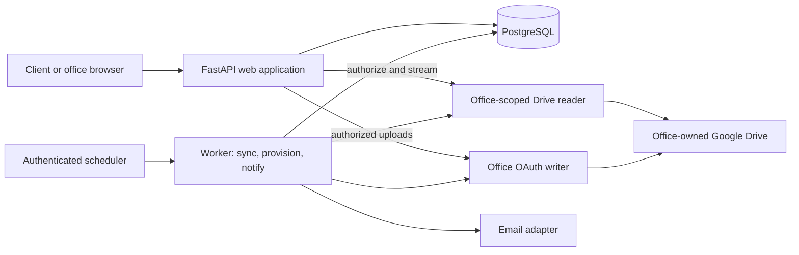

# Multi-tenant portal: architecture, implementation and rollout

**Decision draft · 13 October 2026**

Prepared against repository `main` at `8a21b5b`, the supplied
`multi-tenant-plan.md`, and Fabio's subsequent decisions. The newer decisions
below supersede conflicting parts of the attachment. This document proposes a
new backend; it does not apply migrations, create cloud resources, or authorize
deployment. It separates chosen product behavior, recommended implementation,
verified behavior, and work that still needs external verification.

Framework decision updated after discussion: the new backend will use FastAPI
and Pydantic, while retaining Python. Updated 14 October 2026 (A20), revised 16
October 2026: the client project page and the staff administration are both React
+ TypeScript, built by Vite and served by the same service on the same origin;
the server renders the client page's preview tags and its "not found" answers. Offices
are served at `{office}.myunio.app` behind a load balancer (A21, section 4). References to Flask/Gunicorn in the
current-state inventory and verification history describe the existing
application, not the target backend.

Companion: [infrastructure cost comparison and POC options](infrastructure-cost-comparison.md),
including free-tier assumptions and Cloud Scheduler versus local cron.

[Future ideas](future-ideas.md) collects possibilities outside committed scope,
including templates, finer-grained team permissions, project organization and
WhatsApp updates. This plan remains the source of implementation decisions.

## 1. Product agreement and scope

The product is an architecture office's client portal. Each office keeps its
working files in its own Google Drive. Its staff can continue using Drive, while
clients get a clearer, branded view of deliverables, versions, project progress,
and meetings. Staff also gain a website for creating projects and managing files.

Start with approximately five friendly offices, onboarded personally and probably
free. Aim to put a useful pilot in their hands in the next few weeks. After
feedback, expand to another 10–20 early offices, likely paid. Engineering time is
variable, including nights/weekends. AI assistance should shorten implementation;
release readiness is determined by evidence rather than an assumed coding speed.

Confirmed choices:

- Keep Python; use FastAPI and Pydantic for the new backend. The client project
  page and the staff administration are React apps on the same origin; the
  client page is its own small bundle, and its edit mode is the same page with
  controls switched on (A20).
- Build a clean multi-tenant backend instead of threading tenant parameters
  through the prototype's single-office backend.
- Office URLs: `{office-slug}.myunio.app`, behind a load balancer (A21, section
  4; chosen 17 Oct 2026 over one domain with office paths). Display-name changes
  do not silently change URLs. The product is Unio, on
  `myunio.app` (A33). The first office keeps its own domain, `alineaarquitetos.com`, as a
  custom domain of the same deployment (A23); `{office}.myunio.app` is for later offices.
- Project links are simple: `/{project-slug}` on the office's address, as today
  (A22). Optional per-project passwords cover projects that need privacy.
- Creating a project asks for its name, the client's name and its type, whose
  usual stages come ticked and can be changed (A27). Details, meeting, cover
  image and files are edited afterwards: content in a staff edit mode on the
  project page, settings in the painel (A24).
- Files are versioned as `v1, v2, v3`: "send new version" on a file, and an
  upload with an existing name offers to become its next version (A25).
- PostgreSQL owns project metadata. Drive owns file bytes and physical folders.
- Use office-user OAuth with `drive.file` for writes, and an explicitly shared
  service account for reads. Fabio has tested the essential split successfully.
- Automatically publish files placed in the designated client-deliverables
  folder. A separate manual approval step is not required for the pilot.
- Public project links are supported. Password protection is optional per project.
  Office administration always requires authentication and authorization.
- Start with email update digests, grouping nearby uploads; support other channels
  later through a small delivery interface.
- Start with constrained office branding, then expand templates/customization.
- Keep Drive ownership and familiar workflows as product advantages. Hosting the
  offices' originals ourselves is a possible future option, not pilot scope.
- Preserve the working office's existing site until migration is proven.

Personal Gmail/My Drive is the first account type to validate. Workspace My Drive
and Shared Drives remain intended supported configurations, but each needs a real
acceptance result before we advertise it. Unknown account types are an onboarding
question, not a reason to require offices to purchase Workspace.

## 2. Decision register

“Recommended” means a concrete default for implementation review, not something
already deployed. A change to a recommendation should update this register and
its affected tests before coding proceeds.

| ID | Decision | Status and reason |
| --- | --- | --- |
| A01 | New backend in the same repository, retaining Python and the client-page UI | Agreed direction; replace the Flask backend with FastAPI rather than preserve the prototype's architecture. Staff UI direction revised by A20 |
| A02 | Modular application, one database, shared web deployment | Recommended; independent web/worker processes can use the same code and image |
| A03 | PostgreSQL + SQLAlchemy 2 + Alembic + psycopg 3 | Recommended; relationships, transactions, migrations and local parity |
| A04 | OAuth writes + service-account reads | Product choice, core flow reported tested by Fabio; remaining capability matrix below. **Hard ordering constraint on provisioning** — see section 9 |
| A05 | Tenant and project checks on every resource path | Required even for public projects; public within one office does not mean cross-office access |
| A06 | Public or password-protected project access | Agreed; no mandatory client account for the pilot. Details agreed 16 Oct 2026 (Fabio): staff set the password in the "Projeto" dialog (at least 6 characters, no generator); the client types it once per device and stays unlocked for 90 days; five wrong tries from one device make it wait 15 minutes, with no email to the office; a new password or access mode ends every unlock. See section 6 |
| A07 | All-or-nothing project creation | Pilot (15 Oct 2026): within the request, folders first, then every row in one transaction; on any failure nothing is saved and the new project folder (with its stage folders) is trashed, best effort; a one-time creation key makes retries safe. The durable provisioning operation in section 10 replaces it when there is a worker. See section 10 |
| A08 | Stable document/revision records, not filename-only versioning | Recommended replacement for the prototype's grouping rules. Revised by A25: clear `vN` names still group automatically |
| A09 | Recoverable background work; deployment and dispatch technology open | Revised POC proposal: an authenticated maintenance endpoint in the web service, called every 10 minutes (15 Oct 2026, was hourly), with durable application state. Managed queue/separate worker deferred unless needed. See section 4. |
| A10 | The client page reads Drive live; the sync job only notices changes | Revised 16 Oct 2026 (Fabio): a project page lists its stage folders from Drive on each visit, so a file added in Drive shows at once (staff) or within two minutes (a public page's browser cache). The incremental, polled sync no longer feeds the display; it records what changed, for emails (A12), "Atualizado" and the updates feed (A28); versions are worked out from the listing itself (A25). Reconciliation stays the repair path; webhooks can wake it later without becoming a correctness dependency. For the pilot it finds new files by scanning each published project's stage folders every pass rather than reading Drive's changes feed (Fabio, 16 Oct 2026). See sections 8 and 13 |
| A11 | Streaming proxy for private Drive content; optional Drive links | Recommended; clients need not have Google accounts or Drive sharing permissions |
| A12 | Email first, trailing "settle" window: send once uploads stop | Revised 14 Oct 2026 from a fixed 60-minute window. 45-minute quiet period, 2-hour maximum hold from the first publication, configurable per office. Clarified 15 Oct 2026: a batch becomes *due* by these rules and is *sent* by the next maintenance run (every 10 minutes); the delay prevents an email about withdrawn files, it does not hide them. See section 14 and the [changelog](decision-changelog.md) |
| A13 | Protected main, staging and approved promotion of one build | Recommended; environments are separate without requiring permanent divergent code branches |
| A14 | Same PostgreSQL engine locally and in production | Recommended; SQLite cannot validate the intended constraints, queue locks or row policies |
| A15 | Cloud Run web with bounded maintenance execution | Proposed hosting continuation; POC can run maintenance in the same service. Actual infrastructure requires separate approval |
| A16 | Managed PostgreSQL: Cloud SQL for PostgreSQL, one small instance in us-east1 holding separate staging and production databases | Agreed 14 Oct 2026, replacing Neon as the candidate. Same region as Cloud Run, so about 1 ms per query instead of roughly 10–15 ms to another cloud; Cloud Run's built-in connector and IAM login instead of a stored database password; daily backups kept 7 days. About $9–10/month for the smallest shared-core instance (verify at creation). Split staging onto its own instance, or upgrade the machine, when load or the number of offices calls for it. See the [changelog](decision-changelog.md) |
| A17 | Resend behind an email adapter | Proposed first provider; choose a plan based on actual volumes and delivery limits |
| A18 | FastAPI + Pydantic + Uvicorn for the new web backend | Agreed framework switch; validated request/response contracts, dependency injection and native async support; Cloud Run remains compatible |
| A19 | Cloud Scheduler preferred within its free allowance; local cron retained as an alternative | User accepts managed scheduling when free. Both call the same protected maintenance endpoint; cadence and deployment shape remain separate decisions. See the [cost comparison](infrastructure-cost-comparison.md). |
| A20 | Client project page and staff administration both React + TypeScript, built by Vite, served by the same FastAPI service on the same origin | Agreed 14 Oct 2026 with client pages in Jinja; revised 16 Oct 2026 (Fabio): since the project page is also where staff edit content (A24), one React page serves viewing and editing instead of two copies of every section. The client page is a separate, small bundle (staff editing code loads only on "Editar"). The server still answers before any script runs: the preview tags (title, description, cover) that messaging apps read, "not found" for drafts and unknown addresses, redirects from old addresses, and the password check. One image, one Cloud Run service. See section 4 and the [changelog](decision-changelog.md) |
| A21 | Office address scheme: **office subdomains, `{office}.myunio.app`, behind a global load balancer** (option A) | Agreed 17 Oct 2026 (Fabio), choosing between the two options recorded 14 Oct. Each office is its own origin (cookies, storage and script bugs stay inside one office), addresses read as the office's own, and custom domains fit later. The load balancer (~$18.25/month plus processing; Fabio has credits for the first three months) is a global external Application Load Balancer with a serverless backend for the production service, certificates from Certificate Manager (DNS authorization at GoDaddy) covering `*.myunio.app`, `myunio.app` and each office's own domain (`alineaarquitetos.com`, `www.`) before its DNS moves, and Cloud Run ingress limited to it. It is built before the second office's first client link; `alineaarquitetos.com` and `myunio.app` move behind it then, leaving Cloud Run domain mappings (Preview, "not recommended for production"). Staging keeps its domain mapping (`staging.myunio.app`, one office), so it does not pay for a second balancer. See section 4 and the [changelog](decision-changelog.md) |
| A22 | Project links are `/{project-slug}` on the office's address; no random token | Agreed 14 Oct 2026, replacing `/p/{public_token}/{slug}`. Readable and shareable, and the first office's existing links keep working unchanged. Guessable by design; privacy comes from the optional password (A06). Slugs are unique per office and stable once shared. See section 6 and the [changelog](decision-changelog.md) |
| A23 | First office served on its own domain (`alineaarquitetos.com`) as a custom domain of the shared deployment | Agreed 14 Oct 2026. No separate deployment: `tenant_domains` maps the hostname to the office. Custom domains stay deferred for other offices; this one is the exception because it predates the product domain. Hosting settled 15 Oct 2026: the domain and `www` are already free Cloud Run domain mappings (with managed HTTPS) on the `portal` service; the rewrite ships as a new revision of that same service, so the mapping and its cost do not change |
| A24 | Minimal project creation; content edited on the project page, settings in the painel | Agreed 14 Oct 2026. Creation asks for the project name and the client's name (shown prominently in the painel), plus the project type and its stages (A27). Revised 20 Oct 2026 (Fabio): it also asks, optionally, for the client's email addresses (A32), so the updates start with the project. Narrowed 16 Oct 2026: day-to-day content (description, details including project type, stages, progress and completion, meeting, files) is edited only in the staff edit mode of the project page. The painel edits the project's settings in the prototype's "Projeto" dialog: name, client, client link and access (with the client page, slice 2) and the client's email addresses (A32). Revised 19 Oct 2026 (Fabio): the card's pencil (a "⋯" since the painel redesign of 22 Oct 2026) opens a short menu instead of the dialog at once: "Trocar foto" (straight to the photo picker and cropper, saved on its own), "Remover foto" (when there is one), "Configurações do projeto" (the dialog, without the cover) and "Arquivar projeto", which asks for confirmation first. No delete for now. Uploads happen per stage on the project page. Revised 28 Oct 2026 (Fabio): "Nova proposta" opens the same form and starts the project as a proposal (A42); since 29 Oct it is in the Propostas tab. Revised 29 Oct 2026 (Fabio): besides ticking built-in stages, creation adds the office's own by name ("Outra etapa"), after the built-in ones; and a new project opens its page at once instead of a toast in the painel. Revised 18 Oct 2026 (Fabio): the name can also be changed from the title in the project page's edit mode (the same change as the dialog's; the address stays). See section 10 and the [changelog](decision-changelog.md) |
| A25 | File versions named `v1, v2, v3`; "send new version" and same-name upload prompt; automatic grouping of clear `vN` names | Agreed 14 Oct 2026, revising A08. Uploading a file with an existing name asks whether it is a new version; if so it is stored as the next `vN`. Existing files are never renamed (the write scope cannot rename files the app did not create); an unnumbered original counts as v1. Refined 15 Oct 2026: the client page shows the clean name with a separate version badge, while the copy in Drive carries the version (`Planta v3.pdf`); grouping only within one folder; clashes are flagged, never merged; current = highest version. Revised 25 Oct 2026 (Fabio): no document index. Versions are worked out from the file names each time a folder is listed, as the page already lists Drive live (A10); nothing about files is stored, not even staff corrections: the names decide, and a wrong grouping is fixed by renaming the file. The current version is always the highest. No label per version for now. Only `v` numbers mark a version, and a file shows its version from v2: v1 appears only in the file's list of versions. See section 12 and the [changelog](decision-changelog.md) |
| A26 | Built-in options live in code and are translated; office-written content is stored as typed | Agreed 15 Oct 2026. Refined the same day: values the code **acts on** (status, access mode, roles, a detail's value type, languages, error codes) are enums stored with a CHECK; **content the app only displays** (project types, detail types, built-in stages with their descriptions, each type's usual stages) lives in reference tables with its texts per language, referenced by foreign key, and the code keeps enums naming the built-in rows (a test keeps them in step). Interface text lives in one translation catalog per language shared by the server and the staff app. Anything an office writes (custom details, custom stages, notes, descriptions) is stored as text and never translated. "Supports a language" means the product's own text and built-in options are translated. See sections 7 and 16 |
| A27 | Typed project details; project type chosen at creation, with its usual stages | Agreed 15 Oct 2026 (prototype review). Details are text, choice, area (m²) or date, formatted per language. Project type is a column with four built-in types: Projeto Arquitetônico, Projeto de Interiores, Projeto de Reforma, Projeto de Paisagismo. Revised 16 Oct 2026 (Alinea's partners): creation asks for the type; all 11 built-in stages are listed in one fixed order (12 until 26 Oct 2026, when "Levantamento e Diagnóstico" merged into "Levantamento"), the type's usual ones ticked, and staff tick or untick any. Each type gives its stages its own description; a stage outside its type's list uses a general one. Built-in stages have a description only (no separate deliverables). Stage templates are gone. The pilot offers only built-in details, types and stages; office-defined ones are a later addition. See sections 7 and 10 |
| A28 | One feed of client-visible project events | Agreed 15 Oct 2026 (prototype review). New files and versions, stage notes, stage progress (a stage completed or reopened, the project completed; before 23 Oct 2026 a stage advanced; reopening since 25 Oct 2026) and meeting changes are recorded once as `project_events`; the client page's "latest updates" panel, the project's "last updated" date and email batching (A12) all read it. Which of them email: A32 (not notes). See sections 7 and 14 |
| A29 | A project address (slug), once used, stays reserved for that project | Agreed 15 Oct 2026. Old slugs keep redirecting and can never be given to another project in the office, so an old client link cannot land on someone else's project. See section 6 |
| A30 | Staff app and API stay compatible across a deploy | Agreed 15 Oct 2026, correcting "one revision means the staff app can never run against another API version": an open tab keeps the old code. Fingerprinted assets, a build ID on API responses, a reload prompt that keeps unsaved edits, and API changes compatible with the previous release. See section 4 |
| A31 | Uploads go from the browser straight to Drive | Agreed 16 Oct 2026 (Fabio), first part of slice 3b. Any staff member uploads into a stage from edit mode. The app checks the request (staff, project not archived, the stage's folder, at most 100 MB a file) and opens a Google resumable upload in that folder through the office's grant; the browser sends the bytes to Google, never through Cloud Run. A file named like a document already in the stage is saved as its next version or kept beside it under a distinct name ("Planta (2).pdf"), as staff choose (A25). The 100 MB cap settles the upload cap that section 24 listed as open; usage metrics (future ideas) may move it. "Ocultar do cliente" renames a file with a leading `_` (A05's hidden names); the office's grant (`drive.file`) reaches only files the app uploaded, so a file put straight into Drive is hidden by renaming it there. Versions, covers in Drive and usage metrics are later. Refined 26 Oct 2026 (Fabio): staff make **sections** of a stage on the page ("Nova seção"): a subfolder of the stage's folder, one level, as the page already lists them. The page says "seção", never "pasta". Staff see a new, empty section at once, with its own drop area; clients see a section once it holds a file. Uploads, the version check and "Mover para…" name a section by its name, never a Drive id; two sections of one name are refused. Refined 28 Oct 2026 (Fabio): a section's "⋯" offers "Renomear seção" and "Ocultar seção". Hiding renames its folder with a leading `_`, as "Ocultar do cliente" does a file: the section and its files leave the page (for staff too) but stay in Drive, which the question before it says. There is no "remove": files are never moved or deleted by it. Like files, only a section the app made can be changed (`drive.file`); for one made in Drive the site says to change it there. See section 11 and the [changelog](decision-changelog.md) |
| A32 | Client email updates: what, to whom, from where, and how often | Agreed 16 Oct 2026 (Fabio). Staff list the client's addresses in the Projeto dialog, several per project (`project_recipients`). Revised 20 Oct 2026 (Fabio): they are an important part of the process, not an afterthought, so creation asks for them too (A24), and a project nobody receives updates for says so: "Sem e-mail do cliente" on its painel card, and a notice in the project page's edit mode, each leading to where the addresses are added. Also 20 Oct 2026: clients sign themselves up from the project page ("Novidades por e-mail"). The address is listed at once and gets a welcome email saying so, with a small "Não foi você?" link to stop them (the updates' own unsubscribe link); no confirmation step (Fabio: simpler for clients). Requests are rate-limited per device. A client who had unsubscribed may sign up again this way (their own choice; staff still can't). Not for archived projects, and not past the 20 addresses. An email goes out for new files on the page, a stage completed or reopened (one line per stage whose state, when it is sent, differs from before the email's changes; revised 23 Oct 2026, it was a stage advanced; reopening added 25 Oct 2026, Fabio, and the reopen confirmation says the subscribed clients will be emailed, as completing's does) or the project completed, and a meeting scheduled, changed or removed; a stage's note does not email (it still counts for the updates panel). Batching as A12, 45 minutes quiet and 2 hours at most, confirmed for the pilot. Each office sends from its own domain once that domain is verified with the provider (Alinea: `alineaarquitetos.com`); until then, and for every other office, from the product's general domain with the office's name. Replies go to the office's contact email (office settings), else its owner. Locally and in tests a collecting fake records emails; staging sends only to allowlisted addresses. One Cloud Scheduler job calls the maintenance endpoint every 10 minutes (A09, A19), staging first. See section 14 |
| A33 | Product name and domain: **Unio**, `myunio.app` | Agreed 17 Oct 2026 (Fabio). `myunio.app` is the `{product-domain}` throughout this plan, registered at GoDaddy. Alinea keeps `alineaarquitetos.com` (A23); later offices are served at `{office}.myunio.app` (A21). `.app` domains are HSTS-preloaded, so every address on it works over HTTPS only (Cloud Run's managed certificates already do that). Hosting region is still open (section 24). See the [changelog](decision-changelog.md) |
| A34 | Staff change files on the website, not in Drive | Agreed 17 Oct 2026 (Fabio). The project page does not send staff to Drive: no "Abrir no Google Drive" action on a file or stage. (The Drive settings page keeps its link to the office's connected folder: that is about the connection itself, not a way to change a project's files.) Drive keeps working for whoever prefers it, but every everyday change is offered on the project page. Each file's "⋯" menu offers "Definir como capa" (images), "Mover para outra etapa" (a list of the other stages) and "Ocultar do cliente"; dragging a file card onto another stage, or into a section, does the same move (built 28 Oct 2026; not on touch screens, where the menu stays). A file put straight into Drive can be shown but not changed through the office's grant (drive.file): the site says, in plain words, to make that change in the stage's folder; authorizing such files through the Picker stays a later option (section 9). See section 11 and the [changelog](decision-changelog.md) |
| A35 | No drafts for now: a new project is published at once | Agreed 17 Oct 2026 (Fabio). Creation makes the project `active`, so its client page answers as soon as it exists; there is no "Publicar" step or "Rascunhos" group. The `draft` status stays allowed in the database, unused, so drafts can return without a schema change; existing drafts were published (migration 0024). Revised 19 Oct 2026 (Fabio): the staff bar says nothing about publishing, neither "Publicado" nor a "Publicar" button on a draft; the publish endpoint stays, unused, for when drafts return. Replaces the draft step of 15 Oct (section 10). See the [changelog](decision-changelog.md) |
| A36 | Owners invite staff from the painel: a personal invite, or a shared office link | Agreed 20 Oct 2026 (Fabio), bringing forward the invitation screen section 5 had deferred. In Configurações → Equipe ("Convidar pessoa", a dialog under the team list) an owner invites a person by name, email and role: the app creates the account without a password and emails a one-time link to choose one (the existing invite link, 7 days), with "Copiar link" to send it another way; a pending invite can be sent again or cancelled. An owner can also turn on one shared office link, to post in a group: whoever opens it gives a name, an email and a password on one page and is signed in, but the account does nothing except confirm the email until a 6-digit code emailed to it is typed in, or the email's link is pressed (revised 25 Oct 2026; section 5: invitations bind a verified email). The screen offers "Reenviar código" (once every 2 minutes) and "Corrigir e-mail" (only while unconfirmed), and signing in again brings it back; the code works only in that account's own session, 5 wrong codes use it up, and 5 wrong in 15 minutes per account make it wait; code and link last 24 hours. Equipe shows "E-mail não confirmado" until it's done. An invite or reset link used counts as confirmation too. A shared link ("Convidar através de um link") always makes a member, never an owner; it works for 24 hours (Fabio: a link passed around goes stale); only its hash is stored, so it can be copied when made, and making a new one turns the old one off. An address that already has an account is refused ("Já existe uma conta com este e-mail"): only someone holding the office's link learns it, at the rate limit (Fabio, 25 Oct 2026); requests are rate-limited per device. A deployment operator can create a one-time owner signup link with `make owner-link TENANT=…`, without knowing the person's name or email (approved 25 Oct 2026). It lasts 7 days by default, is consumed atomically when the account is created, and requires the same email confirmation before the owner can act. Owner links are separate from the painel's member links: turning the shared link on or off never changes them. Removing active staff and changing roles come later. See section 5 and the [changelog](decision-changelog.md) |
| A37 | Clients and staff share files by link ("Compartilhar arquivos") | Agreed 25 Oct 2026 (Fabio), from the idea in future ideas. From the project page, anyone who can see it (the client, or staff) picks files from any stages and gets a link to send, say to a supplier for a quote; the supplier needs no account. One panel, opened above the stage list or from a stage (its files ticked). Files hidden from the client never appear. **A link serves the exact versions it was made with**, so a quote matches what was sent: renamed or moved to another stage, a file stays in it; hidden, trashed or taken out of the project, it drops out, and the supplier's page says how many are no longer available. When a file in a link has a newer version, the links list says so, and "Atualizar link" moves the same address to the newer versions. The sender picks the expiry (7 days, 30 days, none) and an optional "Para quem?" label. Staff see every link of the project (label, who made it: the staff member's name, or "Cliente"; files available; dates; downloads), copy any of them again, and can turn any off ("Desativar"); a client sees, copies and turns off only the links made on their own device (Fabio, 25 Oct 2026: kept per device, since anyone with the page's address counts as the client). Limits: 300 MB per link, checked when it is made; a few new links per device every 15 minutes; 5 GB of downloads per link per day ("Este link atingiu o limite de downloads de hoje"), no cap on links per project. Links work without the project's password, which the sender already had; staff turn a link off to stop it. The sender can add a password to a link, typed once per device as a page's. "Baixar tudo" downloads every file as one zip, a folder per stage, counted against the day as its whole size (built 25 Oct 2026). See section 15 and the [changelog](decision-changelog.md) |
| A38 | An operator dashboard for Unio: offices, health, support and office lifecycle | Agreed 26 Oct 2026 (Fabio). At `myunio.app/admin` only (never on an office's address: 404 there), in the same app and deploy. Operators sign in with Google; only emails on an allowlist set in the deployment (not the database) get in, with their own session apart from office staff logins. It shows every office with operational counts and health, and finds a support ID's log line; no client content (file names, project texts). Actions: create an office with its owner link, a new owner link, suspend (offline, reversible) and, only for a suspended office with its name typed, delete (our data only; the office's Drive files are never touched). Every operator action is audited. Cross-office reads use the app login, scoped to one tenant at a time; lifecycle actions use a separate, limited login. Built in slices: read-only, actions, then PostHog groups (PR #106). Proposed 28 Oct 2026 (Fabio asked; for his review): an operator can also make a one-time **link to create an office** (7 days, only its hash kept). Its holder opens `myunio.app/criar-escritorio`, names the office and picks its address (`{address}.myunio.app`, free and not reserved), and the app creates both through the lifecycle login, using up the link in the same transaction and auditing it as `signup-link:{id}`. The browser then goes to the new address's owner signup (A36), so the page creates no account itself. It is the base for a public signup page later: the same page without the link, plus abuse controls. See section 21 and the [changelog](decision-changelog.md) |
| A39 | Product analytics with PostHog: staff actions by account id, role and office; clients' and visitors' use without cookies or identity | Agreed 26 Oct 2026 (Fabio), from the PostHog wizard's setup. The backend sends staff actions (sign-in and out, a password set, a project created or its content saved, a meeting set or cleared, a stage added or completed, a project completed, a share link made, renewed or turned off; a stage renamed, moved or removed; a project published or its cover set; the office's settings or logo changed; Drive connected or disconnected; the page tour finished; an upload started or failed, with its size; a section made; a file hidden or moved; how a staff member signed in) to PostHog, each tied to the account's id (never its email or name) with its role, and to the office as a `tenant` property and PostHog group. Clients and suppliers stay personless. Extended 26 Oct 2026: server-side `file_transfer` events record application-emitted bytes, completion and source (preview, project download, share download or zip; thumbnails are not counted, one event each would outnumber everything else), always personless, with no file names. Extended 28 Oct 2026 (Fabio): what clients and other visitors do is recorded too, still without cookies, person profiles or names. The server sends a project page unlocked (or a wrong password), the meeting's calendar file, a share page opened or unlocked, an email address subscribed or unsubscribed, and update emails sent per office (count, for cost; the emails' links carry `utm_source=email`); each visitor event (and each `file_transfer`, with whether staff or a visitor downloaded) carries an anonymous visitor id that changes every day (a keyed hash of the address, browser and date, never stored) and the device kind (phone, tablet, computer), so distinct visitors can be counted but not followed across days. Unhandled server errors are captured too. It runs only where `POSTHOG_PROJECT_TOKEN` and `POSTHOG_HOST` are set: production, not staging, local runs or tests (the old app's `.env` is not read). No PostHog Logs export. In the browser, PostHog starts only for signed-in staff, from the key `/api/me` gives them (one image serves staging and production, each with its own key or none); it is loaded only then, from PostHog's self-contained build (no scripts from PostHog's servers; the Content Security Policy only lets events out), with the same id, role and office, clicks without their text, no session recording, and unhandled errors. On project pages, visitors who aren't signed-in staff get PostHog's cookieless mode (`cookieless_mode: "always"`, no person profiles, nothing stored in the browser; PostHog's own daily hash), from the key `/api/tenant` gives: page views, where they came from (an update email's link says so), clicks without their text and a few named actions on the page; no session recording. No browser event carries a project's or file's name: the page title is dropped, a project page's address (made from the project's name) is sent as `/projeto` with the project's id alongside, and addresses keep only their `utm_` tags (a file's link names it in the query; a sign-in link carries a token). A share link made, renewed or turned off by a client counts as a visitor's event, not staff's. Events the server already sends are not sent again from the browser. The privacy policy names PostHog and says what is measured on project pages. See the [changelog](decision-changelog.md) |
| A40 | Features switched on per office, from the operator dashboard | Agreed 28 Oct 2026 (Fabio): work Fabio isn't sure about yet must reach staging (and main) without being turned on for every office, so his partners can try it and other deploys never wait for it. A feature is a `Feature` value in code; `tenants.features` lists the ones an office has. Off by default; the operator dashboard switches each on or off per office, audited like the other lifecycle actions, and only the operator role may change the list. The request's tenant carries its features; the API refuses a switched-off feature's changes (`feature_off`) and leaves its data out of responses; `/api/me` gives the screens the list. No CHECK on the stored names, so a feature comes and goes without a migration; one the code no longer knows is ignored. A feature is removed from the code once every office has it. Not PostHog's feature flags: those would put an outside service on the request path and evaluate per person rather than per office. See the [changelog](decision-changelog.md) |
| A41 | Who works on a project: its members, from the office's staff | Agreed 28 Oct 2026 (Fabio), behind the `project_members` feature (A40). The Projeto dialog ticks any of the office's staff accounts ("Equipe do projeto"), several per project; only accounts of the office, never a typed name. The painel's "Responsável" chips and "Meus projetos" then filter by account. The client page names the members as "Responsável" (or "Responsáveis"), by their account names; the typed "Responsável" detail is neither offered nor shown while the feature is on, and offices without it keep that detail as before. Membership organizes, it doesn't restrict: every staff member still sees and edits every project (section 5). A removed account leaves its projects. See section 5 and the [changelog](decision-changelog.md) |
| A42 | Proposals: a "Proposta" project status and a generated proposal PDF | Agreed 28 Oct 2026 (Fabio). Behind the `proposals` feature (A40), off until the operator dashboard switches it on for an office: without it there is no Propostas tab, no proposal buttons on the proposal page, no "Dados para propostas" in Configurações, and the proposal API answers `feature_off`; client pages still show proposals made while it was on, so links already sent keep working. Any staff member generates a proposal PDF for a project from its page, in the office's branding (owners only may come later). Revised 29 Oct 2026 (Fabio): an accepted proposal is fixed, what the client agreed to: no new versions (saving answers `proposal_accepted`), and the project's staff bar no longer links to the generator. Revised 29 Oct 2026 (Fabio): proposals have their own painel tab, "Propostas", beside Projetos and Configurações, listing them as "Ativas", "Aceitas" and "Recusadas"; "Nova proposta" is there, not beside "Novo projeto", and the projects list leaves open proposals out. A project starts in the new `proposal` status when created from "Nova proposta", which opens the same creation form (type and stages included), no new step, and leads straight to the proposal generator; the generator offers only the writing, and saving goes to the proposal's page as the client sees it. While in it, the client page shows only the proposal (on the page and "Baixar PDF") and the office's contact details: no stages, files or updates. From that page staff mark it accepted ("Proposta aceita", asked first as "Criar o projeto a partir desta proposta?"): the same record becomes the `active` project and its page shows the work. Or they mark it declined ("Recusada"): it is archived while a proposal, listed under "Recusadas" and reopened from there. A proposal's services are its own list, not the project's stages, and have their own texts, separate from the stage descriptions; the office saves its versions of them as presets. The PDF follows the example proposals: logo, office address/phone/WhatsApp/email footer, city and date, "Prezado(a)" and the client's name, an intro, numbered services with descriptions, fees (the amount also written out in words), payment instalments, services not included, observations, and two signature lines. Office details it needs and lacks are asked once in the generator and saved to the office's settings. Revised 28 Oct 2026 (Fabio): when an owner saves a proposal whose office details differ from the office's, they are asked whether to update the office with them ("Atualizar escritório" / "Só nesta proposta"); members are not asked, and a proposal's changes stay its own. One fixed layout; every text editable per proposal. No online acceptance or negotiation. Generating does not email the client: staff send the page link themselves, as they may present it first. The client sees only the latest version; earlier ones stay for staff. After acceptance the project page shows it as a first stage, "Proposta", holding its PDF (drawn from the latest version; not one of the project's stages), for staff and client. See section 10 and the [changelog](decision-changelog.md) |

Explicitly deferred: full billing automation, SMS/WhatsApp, custom customer
domains (except the first office's existing domain, A23), multiple portal templates, SSO, arbitrary custom CSS/HTML, client
accounts, comments/approvals, complex professional-level pricing, hosted
original-file storage, and staff roles beyond owner/member (see section 5).
These are extension points, not parallel pilot projects.

## 3. What to retain and what to replace

The current app is a useful behavior reference, not the architecture to generalize.
It has one global Drive root, office identity, language, timezone and dashboard
password. `ProjectStore` combines Drive traversal, metadata parsing, visibility,
cache management and view models. Office configuration is read from environment
variables, and some branding is hardcoded. Project metadata is parsed from
`_project` and stage text files. The dashboard uses a shared password. Downloads
already stream through Flask. The notification bell is a browser-local recent-file
indicator; it does not provide reliable email notifications.

Retain or selectively adapt:

- The client page layout, timeline, meetings, search, collapsible stages, theme
  toggle and small JavaScript components.
- Portuguese copy and translations, moved into tenant-aware/request-local rendering.
- Parsers as **legacy import tools**, with characterization tests for old inputs.
- Existing fake Drive, editable-folder simulator, generators and local backup flow.
- Small Drive HTTP utilities when their behavior fits the new adapter contract.
- Tests for hidden-file access, previews, stage behavior, mobile layouts and exports.

Replace:

- Global office configuration and in-memory project discovery as the source of truth.
- Shared dashboard passwords and signing keys derived from them.
- Filename matching as authoritative version identity.
- Request-time recursive Drive discovery and process-local background work.
- Bare provider file IDs as the application's only file identity.

Build a separate package such as `backend/` with its own application factory and
entry point. Keep `app.py` available for the legacy site until migration. Reuse
presentation components deliberately; do not maintain two permanently equivalent
products. Transfer the selected UI into the new entry point, establish parity,
then remove legacy runtime code after the rollback period. Old parsers remain
available to imports for as long as supported.

Suggested layout:

```text
backend/
  app.py                 application factory, dependency wiring
  config.py              typed deployment settings; no tenant state in env
  tenancy/               hostname resolution and tenant context
  identity/              staff accounts, sessions, password links
  projects/              project metadata, stages, access policies
  documents/             versions from names, previews
  storage/               provider contract, Google adapter, fake adapter
  connections/           OAuth lifecycle, read identities, capabilities
  sync/                  cursors, reconciliation and change normalization
  notifications/         subscriptions, batching, delivery adapters
  jobs/                  leases, retries, durable work and outbox
  branding/              validated themes and assets
  web/                   FastAPI routers, forms, Pydantic request/response models
  db/                    models and repository implementations
migrations/              reviewed Alembic migrations
frontend/             React + TypeScript: staff administration and the client page (A20), built by Vite
  src/                   screens, components, API client generated from OpenAPI
  package.json           own lockfile; Node is used to build, never at runtime
```

`backend/` serves both audiences: the client project pages (the page's shell with
its preview tags, and a public JSON API that returns only what the page may show)
and the JSON API the staff app uses, over one shared set of services, so there is
a single copy of rules such as "who may see this file". `frontend/` holds the
source of both React apps (painel and client page) and never runs as a server.

Modules call explicit services; templates do not call Google or construct SQL.
A service takes tenant context and dependencies explicitly. A background job
constructs that context from its stored tenant, never from ambient HTTP state.
Use ordinary Python classes/functions, not a generic plugin or event framework.

FastAPI dependencies provide explicit tenant, staff and service context to route
handlers; services still enforce authorization and database constraints. Pydantic
validates input and controls response fields. Keep input/output schemas separate
from SQLAlchemy persistence models, especially for credentials, password hashes
and internal IDs. Alembic still manages database schema changes. OpenAPI provides
the API contract for the staff app (A20): generate its TypeScript types from the
schema in CI, so a backend change that breaks the staff app fails the build
instead of failing in a browser. The client page uses the same generated types.

Use asynchronous HTTP calls for Drive streaming and an async SQLAlchemy/psycopg
database path in the new request handlers. Initialize reusable clients/pools
through application lifespan and close them on shutdown. Do not call blocking
legacy `requests` helpers directly inside async handlers; adapt or isolate them
during migration. CPU-heavy preview work belongs in bounded worker jobs. FastAPI
background tasks are not the durable provisioning or notification queue.

Port Flask-specific template helpers, redirects, session handling and CSRF
protection explicitly. FastAPI does not supply the application's complete browser
authentication/access policy just by declaring API models. Retain tests for both
server-rendered pages and JSON routes as these integrations change.

Staff app boundaries (A20): it talks only to the JSON API, never to Google or the
database directly, and holds no credentials in browser storage. Authentication is
the same host-only session cookie as the rest of the site; the app reads a CSRF
token from the session and sends it on every state-changing request. The current
prototype's painel (Jinja templates plus small modal scripts) is the behavioral
reference for its first screens.

## 4. Deployment shape and data flow

**POC simplification under discussion:** following the cost review, first evaluate
one web deployment with an authenticated maintenance endpoint called every 10
minutes (A09; Cloud Scheduler charges per job, not per run, and Cloud SQL is
always on, so a shorter interval costs nothing extra). The
worker below is a logical function and need not be a separate deployed service.
The fuller queue and wildcard load-balancer design remains an alternative, not
a prerequisite for the POC. Offices get subdomains behind a load balancer (A21,
below); slower refresh timing still needs agreement.
The cost comparison records those tradeoffs explicitly.



Use one deployable codebase with web and maintenance handlers. The diagram shows
the logical recurring-work path, not a settled choice of queue technology.
Workers process bounded durable work, checkpoint long tasks, and exit before
their request deadline. Never start untracked in-process tasks and assume Cloud
Run will keep them alive.

### One origin per office: pages, staff app and API (A20)

Each office is served by the one FastAPI service, from one origin. The product
domain is `myunio.app` (A33). With office subdomains (A21) the layout is:

```text
{office}.{product-domain}/{slug}             client pages: React, shell and preview tags from the server (A20, A22)
{office}.{product-domain}/painel/...         staff app: React, static files
{office}.{product-domain}/api/...            JSON API used by the staff app
auth.{product-domain}/...                    shared Google login (section 5)
```

Because pages, staff app and API share an origin, the session cookie works
without CORS, cross-site cookies or tokens in browser storage. State-changing
API calls carry a CSRF token (section 17).

How the staff app is served:

1. `vite build` produces one `index.html` plus JavaScript/CSS files whose names
   contain a content hash.
2. FastAPI serves those files under `/painel`. Any other `/painel/...` path
   returns `index.html` and the app's router shows the screen. Unknown `/api/...`
   paths still return JSON 404s, never the app shell.
3. Hashed files are cached for a year (`immutable`); `index.html` is never cached,
   so a deploy reaches staff on their next navigation.
4. Content Security Policy for the staff app: scripts and styles from `self` only.

The image is built in two stages, so Node exists only at build time:

```dockerfile
FROM node:22-slim AS frontend            # supported Node LTS; pin exact version
WORKDIR /frontend
COPY frontend/package*.json ./
RUN npm ci
COPY frontend/ .
RUN npm run build                        # → /frontend/dist

FROM python:3.13-slim                    # production Python target
WORKDIR /app
COPY requirements.lock .
RUN pip install --no-cache-dir -r requirements.lock
COPY backend/ backend/
COPY --from=frontend /frontend/dist backend/static/frontend
CMD ["sh", "-c", "uvicorn backend.app:create_app --factory --host 0.0.0.0 --port $PORT"]
```

Client pages, API and staff app always ship together in one revision, and a Cloud
Run rollback reverts all three at once. That does **not** keep an already-open
browser tab in step (A30): it keeps running the previous build's JavaScript, calls
the new API, and may request lazily loaded files the new revision no longer has.
So: built assets have fingerprinted names (Vite's default) and are cached for a
long time, while the app shell is never cached; every API response carries the
build ID; when the staff app sees a newer build, or fails to load one of its own
files, it offers "Nova versão disponível — recarregar" without discarding unsaved
edits; and API changes stay compatible with the previous release (add fields,
do not repurpose or remove them in the same release). Keeping the previous
build's assets available for a few days is a later option if reloads annoy. `gcloud run deploy --source` builds from
a root `Dockerfile` when one exists. **Adding that file therefore changes how the
current Flask site deploys**: introduce it with the new entry point at cutover,
or keep it outside the source-deploy path until then (section 19).

Local development: Vite's dev server serves the staff app with hot reload and
proxies `/api` to the local FastAPI process. The release check builds the bundle
and serves it through FastAPI, as production does. Only staff app work needs Node
locally; client pages and backend work do not.

### Office address: office subdomains behind a load balancer (A21)

Offices are served at `{office}.myunio.app`, behind a load balancer in front of
Cloud Run (A21, decided 17 Oct 2026). The comparison below is the analysis that
decided it; option B is not an available design.

| | A: office subdomains | B: one domain, office paths |
| --- | --- | --- |
| Example client link | `alinea.{product-domain}/casa-jardim` | `{product-domain}/alinea/casa-jardim` |
| Front door | Global external Application Load Balancer with serverless backend, wildcard DNS and Certificate Manager certificate (DNS authorization). Restrict direct Cloud Run ingress | See "B front doors" below; each has a caveat |
| Fixed cost | ~$18.25/month forwarding rule plus data processing, before traffic | None for the front door itself |
| Tenant resolution | From hostname (`tenant_domains`, section 5) | From the first path segment; every route, link builder and test carries it |
| Browser isolation between offices | Each office is its own origin: cookies, storage and any script bug stay inside one office | All offices share one origin. Cookies need tenant-bound sessions; browser storage is shared; a script bug could affect every office |
| Staff login | Shared `auth.` callback plus single-use handoff to the office host (section 5) | One callback on the one domain; simpler |
| Product feel | Each office has "its own" address; custom domains later fit naturally | Reads as a shared platform; custom domains later still need a load balancer |
| Later change | — | B → A needs permanent redirects for every shared link |

B front doors, as documented by Google
([Cloud Run domain options](https://docs.cloud.google.com/run/docs/mapping-custom-domains)):

- **Cloud Run domain mapping:** no extra charge, but Preview, "not recommended
  for production services" because of latency, limited to some regions (including
  `us-east1`), no wildcard certificates, and maps a hostname to the service root.
- **Firebase Hosting rewrite to Cloud Run:** low cost and GA, but every request
  is cut at **60 seconds**, so long file streams (A11) and slow uploads fail with
  504. Only a cookie named `__session` reaches the app, and it becomes part of the
  CDN cache key. It also needs the Blaze plan.
  ([Hosting serverless limits](https://firebase.google.com/docs/hosting/serverless-overview),
  [cookie handling](https://firebase.google.com/docs/hosting/manage-cache))
- **Default `run.app` URL with office paths:** free and GA, but a Google-branded
  address; acceptable only for an internal POC that shares no client links.

**Decided 17 Oct 2026: A** (Fabio), as recommended: every B front door either is
not production-ready or breaks large file delivery, and B's main saving is about
$18/month, covered by credits for the first three months. The balancer is built
before the second office's first client link; until then the one office is served
through Cloud Run domain mappings (`alineaarquitetos.com`, and `myunio.app` for
Unio's own pages). Staging stays on a domain mapping (`staging.myunio.app`).

The balancer's certificate map must cover every hostname moved behind it, each
authorized in Certificate Manager (DNS authorization) before its DNS changes: a
wildcard covers only first-level subdomains, not the apex or another domain. So:
`*.myunio.app` and `myunio.app` (one certificate), and `alineaarquitetos.com` and
`www.alineaarquitetos.com` (another, or one per office domain as custom domains
arrive). `.app` is HSTS-preloaded, so a gap on `myunio.app` would lock browsers out
rather than warn.

### Scheduling and queue technology: proposal under discussion

The original minute-by-minute scheduler plus PostgreSQL queue was a recommendation,
not an agreed product decision. Separate three responsibilities: a scheduler
decides when recurring work is due, a queue preserves pending work, and a worker
executes it. FastAPI itself does not replace any of these durable responsibilities.

| Option | Technology | Benefit | Main tradeoff |
| --- | --- | --- | --- |
| E: revised POC proposal | One Cloud Scheduler job (every 10 minutes) or local cron → authenticated endpoint in the web service | One deployment; no broker/managed task queue | Slower Drive discovery; bounded work shares web resources; retain retryable state and overlap protection |
| A: original proposal | Cloud Scheduler → Cloud Run worker → PostgreSQL jobs | Few services; portable; easy to exercise against local PostgreSQL | We implement leases, retries, recovery and dispatch; minute polling keeps the DB awake and adds dispatch latency |
| B: managed queue alternative | Cloud Tasks → Cloud Run worker, with Cloud Scheduler for recurring checks/recovery | Managed delivery retries, delayed tasks and dispatch limits; enqueue work promptly | Provider-specific adapter and cloud integration tests; SQL idempotency/outbox still required |
| C: established Python queue | Celery with Redis/RabbitMQ, dedicated workers and Beat for recurrence | Mature Python task ecosystem; useful for substantial continuous work | Additional broker and always-running processes to operate and fund |
| D: dedicated scheduler/worker process | APScheduler or cron plus durable PostgreSQL jobs on an always-on host | Reasonable for a small VM deployment | Own process supervision, availability and coordination; does not fit a scale-to-zero web process |

[Cloud Tasks behavior](https://docs.cloud.google.com/tasks/docs/dual-overview),
[Celery](https://docs.celeryq.dev/en/stable/getting-started/introduction.html),
[APScheduler](https://apscheduler.readthedocs.io/en/master/userguide.html).

Evaluate **E first for the POC**, subject to confirming freshness and domain
tradeoffs. Keep cursors, pending batches, provisioning progress and operation IDs
in SQL; prevent overlapping execution and safely resume partial work. No general
queue framework is necessary. Process within the HTTP request and a bounded
deadline; report unfinished work for a subsequent/manual retry. Verify the
scheduler's identity and allowed caller in the endpoint itself, since the web
service also allows public requests. **Prefer Cloud Scheduler when a free job is
available in the billing account; retain local cron as an alternative.** This
scheduling preference does not require Cloud Tasks or a separate worker service.
Use one shared job for all offices. Before setup, confirm the account-wide free
allowance rather than assuming each project receives its own. Local cron calls
the same protected endpoint with an authorized credential outside the repository,
but processing pauses while its host is asleep or disconnected. Enable only one
timer; both options still incur the same endpoint/database work. See the
[cost comparison](infrastructure-cost-comparison.md) for timer pricing and limits.
Record a last-success time so failures are visible. Check database free-tier
limits and restore needs before selecting a paid plan.

If background volume or latency later warrants a queue, **B is the preferred
Google Cloud alternative**, subject to review. In that alternative use
Cloud Tasks for provisioning steps, synchronization and delayed email delivery;
use a small number of shared scheduler jobs for recurring Drive checks, watch
renewal, reconciliation and recovery. Do not create a scheduler resource per
office/project. Queue payloads contain internal IDs, never documents or tokens.
Tasks have at-least-once delivery and no exact execution-time guarantee: show
provisioning progress and interpret an email deadline as earliest eligibility.

Commit business state and an outbox event in one SQL transaction, then attempt
dispatch after commit. A scheduled rescue pass retries undispatched events;
otherwise a crash between database commit and enqueue could lose work. Keep
application-level job state, deduplication, stale-connection rejection and
reconciliation of uncertain external side effects. Cloud Tasks owns transport
retry timing; avoid an independent SQL retry loop scheduling duplicate attempts.
Persist failure/attention state before acknowledging terminal failures, and
detect stale work if the managed queue exhausts retries.

Under A, begin with one scheduler invocation per minute and a roughly 45-second
work budget. Under B, bounded handlers run on task delivery; recurring Drive
polling remains approximately every two minutes initially. A less frequent rescue
scan can be tuned separately. Neither option lets the database sleep while we
continue frequent Drive polling. Do not claim savings from event-driven delivery
until the polling behavior actually changes.

Local tests run the same handlers using a controllable clock and an isolated
queue adapter; exercise duplicate delivery, retries and crashes after commit.
Real-cloud acceptance separately verifies IAM, delivery deadlines and retry
behavior. A local fake cannot prove the provider's configuration. Choose E, A or B
before implementing dispatch; do not build multiple production queue systems.
The [infrastructure cost comparison](infrastructure-cost-comparison.md) records
cost assumptions and free allowances for this decision.

If a separate worker is introduced, use the same immutable image for both entry
points. Maintenance must reject unauthorized calls, whether its HTTP route is
on the public web service or a separate worker. Runtime credentials have only the access needed
for its jobs. Preview processing has explicit byte/time limits so a large file
cannot monopolize synchronization or email.

Cloud Run is a proposed continuation of current hosting. Managed PostgreSQL avoids
making database maintenance a nights-and-weekends responsibility. The provider is
Cloud SQL for PostgreSQL (A16): one small instance in us-east1, next to the Cloud
Run services, with a separate database and database user each for staging and
production. The app connects through Cloud Run's Cloud SQL connector with IAM
database login, so no database password is stored. Confirm the instance price,
backup retention (daily, 7 days by default), point-in-time recovery and
connection limits when creating it, and prove a restore before it holds an
office's only project metadata. The smallest shared-core machines have no uptime
SLA and few connections: keep pools small and upgrade when the pilot grows.
Region and jurisdiction commitments remain an explicit choice; measure latency
from Brazil. A shared-core instance is always on, so frequent polling does not
change its cost the way it would for a serverless database. Later wake-up optimization is possible without
changing the durable-job model.

For the fuller Cloud Run office-subdomain design, use a global external Application Load Balancer
with a serverless backend, wildcard DNS and a Certificate Manager certificate
issued through DNS authorization. Route office hosts to the same application;
do not create a deployment per office. Cloud Run's built-in domain mapping does
not support wildcard certificates. Restrict the web service's direct ingress so
the intended front door cannot be bypassed, while keeping the worker separately
authenticated. Staging uses its own hostname/certificate coverage and services;
`*.product.com` alone does not cover `office.beta.product.com`.
[Cloud Run domain options](https://docs.cloud.google.com/run/docs/mapping-custom-domains),
[DNS-authorized certificates](https://docs.cloud.google.com/certificate-manager/docs/deploy-google-managed-dns-auth).
Quote load-balancer, certificate and transfer costs before approving infrastructure;
one forwarding-rule price is not the total hosting bill.

To avoid that fixed load-balancer cost in the POC, explicitly choose another
domain path first. A temporary `run.app` URL with tenant paths changes the agreed
URL requirement; individual subdomain mappings preserve it but are Preview and
not recommended by Google for production. Neither is approved by this proposal.
The cost comparison distinguishes a near-free constrained POC from the fuller
wildcard deployment; do not describe ~$65/month as the unavoidable pilot minimum.

Start with small connection pools and capped instances. Calculate maximum DB
connections as the sum of every process's pool across every possible instance,
plus maintenance headroom. Request-scoped sessions close promptly; no SQL
transaction or connection remains open while streaming a large file. A database
outage should yield a recoverable application error, not bypass authorization.

### FastAPI deployment and free-tier implications

The existing repository uses Cloud Run source deployment with Python 3.13 and a
Gunicorn `Procfile`. Google also documents a direct FastAPI source-deployment
workflow; Flask is not a requirement for this hosting path.
[Cloud Run FastAPI quickstart](https://docs.cloud.google.com/run/docs/quickstarts/build-and-deploy/deploy-python-fastapi-service)

For the new backend, explicitly replace the legacy WSGI startup command with an
ASGI server. Proposed command, once `backend.app:create_app` exists:

```sh
uvicorn backend.app:create_app --factory --host 0.0.0.0 --port "$PORT"
```

Declare and pin the server dependency. Start with one server process per
container and tune Cloud Run concurrency/max instances and database pools from
measurements. Keep the legacy `Procfile` unchanged until the new entry point is
implemented and release-ready. With the staff app (A20) the new service builds
from the two-stage Dockerfile above rather than buildpacks; the same caveat
applies: a root `Dockerfile` takes over source deploys of the legacy site. Maintain streaming rather than buffering file
responses; test large transfers, timeout and client-disconnect behavior through
the actual deployment path before migration.

Cloud Run free-tier eligibility depends on resource usage and billing settings,
not Flask versus FastAPI. Prefer request-based billing and zero minimum web
instances initially, accepting cold starts. There is no framework surcharge or
need for an always-running server just because FastAPI uses async. CPU/memory
use can differ, so equal application traffic does not guarantee equal cost.
Build/image storage and outbound transfer have separate charging rules. The
database, wildcard-domain infrastructure and scheduled work need their own budget.
[Cloud Run pricing](https://cloud.google.com/run/pricing)

No promise that the complete multi-tenant product stays free follows from keeping
the web service within its allowance. The framework switch itself does not
require abandoning Cloud Run, purchasing a higher hosting tier or introducing a
separate frontend deployment; neither does the React staff app (A20), which is
static files inside the same image. These are planning decisions only; no live billing
settings, deployment configuration or cloud resources were changed for this update.

## 5. Tenant routing and staff identity

Offices are served on their own subdomains (A21, option A).

Resolve the normalized hostname against a `tenant_domains` table. Accept only
configured product suffixes or explicitly verified custom domains. Reject unknown
hosts; never fall back to the first office. Handle casing, ports, trailing dots
and invalid labels deliberately. Reserve names such as `www`, `auth`, `admin`,
`api`, `beta`, `support` and `mail`. Keep office URL slugs stable and unique.

Behind a proxy, trust forwarded headers only from the actual trusted proxy path.
Do not derive OAuth callbacks or password-reset links from an arbitrary Host
header. Construct external links from stored canonical domains.

Recommended staff login: Google OpenID Connect, separate from Drive connection
consent. Someone may administer a portal without being the Google account that
owns its files. Identify users by verified provider subject, not mutable display
names. Invitations bind a verified email to an office's account; never grant
access merely because a user's email has the office's domain.

**Several staff per office, with roles: foundations now, features later.** From
the first version, an office has any number of staff accounts (`users`, each
belonging to one office, with a role), every staff action goes through one central
permission check, and audit events record who acted. A person working for two
offices has an account in each (decided 14 Oct 2026, see the changelog); a shared
identity across offices (users plus memberships) is a later migration if a real
need appears. Each person has their own login; there
is no shared office password. Owners invite more staff from the painel (A36, 20
Oct 2026): by a personal invite, or a shared office link whose joiners choose a
password at once and confirm their email with an emailed code before the account
works (revised 25 Oct 2026). For a new office's first owner, a deployment
operator runs `make owner-link TENANT=…`: no name or email is needed in advance.
The link lasts 7 days by default (`--days` on the command can change this), stores
only a token hash, and is consumed in the same transaction that creates the
owner account, so concurrent attempts cannot create two owners from one link.
The recipient chooses their name, email and password and confirms the email
with the same code before the account works. These owner links are independent
of the painel's 24-hour shared member link; the team page neither reports nor
revokes them.

Deliberately deferred as an add-on
for larger offices: role-management screens, finer roles (for
example editing projects without access to office settings or the Drive
connection, or read-only staff), and per-project permissions. Do not build these
early; when they come, they extend the permission check and the role values
rather than changing the login or the data model.

Use a maintained OAuth/OIDC library, such as Authlib, with state, nonce, PKCE and
strict callback validation. Centralize Google callbacks on an auth subdomain so
each new office does not require another registered redirect URI. Complete login
on the target office through a short-lived, single-use handoff code. Bind that
code to the initiating tenant and browser flow, store only its hash, and reject
replay, wrong-host and mismatched-browser redemption. Preserve the initiating
browser proof in a host-only cookie. Exact protocol handling gets its own tests
and security review; do not improvise a cross-subdomain token in localStorage.

**Built (26 Oct 2026): "Entrar com Google" on the painel's sign-in page**
(`backend/web/google_signin.py`, sharing `backend/operators/google_signin.py`
with the operator dashboard). The callback is on Unio's own address (the one
`GOOGLE_SIGNIN_REDIRECT_URI`, `…/api/auth/google/callback`, the same as the
operator dashboard's); it forwards the return to the office address named in
the signed `state`, only if that address is registered to that office. The
hand-off is Google's own authorization code rather than one the app mints: it
is single use and short lived, and redeemable only with the PKCE verifier kept,
with the state and nonce, in a signed cookie for the office's address alone, so
replay, another office's address and another browser are refused as this
section asks, with nothing of ours to store. Google signs in an existing
account of that office by its verified email (and confirms it, under the same
per-account lock as codes and links), never creates one, and doesn't accept a
pending invite (its link does, first); passwords keep working. Code exchanges
are rate-limited per device (5 failures in 15 minutes, as passwords), for
offices and operators alike; a failure's support code comes back with the
redirect. Sign-up and owner links don't offer Google yet.

Staff roles for the pilot:

| Actor | Read public project | Administer project/files | Invite staff / Drive connection / office settings |
| --- | --- | --- | --- |
| Anonymous visitor | Yes, or project password challenge | No | No |
| Office member | Yes, including password-protected projects through staff access | Yes within their office | No |
| Office owner | Yes | Yes | Yes |
| Platform operator | No automatic customer-content browsing | Explicit audited support action only | Operational tools with audit |

Keep roles small. Store an optional responsible professional and later project
assignments without making every office adopt a complex permission hierarchy.
Project members (A41) are those assignments: they organize the painel and name
the responsible on the client page, but grant or remove no access.
Owner transfer must leave at least one owner. A revoked membership invalidates
sessions or is rechecked on each administrative request.

Use random secret signing material independent of user passwords; server-side
sessions with rotation on login, secure/HttpOnly/SameSite cookies in production,
and **no parent-domain cookie** shared by every office. Staff mutations use CSRF
protection. Password attempts, login handoffs and invitations are rate-limited.
Local test mode uses an explicit fake identity provider and is refused in
production configuration; it must never become a hidden production bypass.

## 6. Public projects and optional passwords

Choose `access_mode = public | password`. Public means a person with the URL can
view and share the page without signing in. Default to unlisted pages with
`noindex`, no public office-wide project directory and no referrer leakage.
These reduce accidental discovery; they are not access control. Explain this
plainly when an office chooses public access. A publicly accessible project need
not make the underlying Drive folder publicly shared.

Route (A22): `https://{office address}/{project-slug}`, as the current site does.
Slugs are unique per office, readable and stable once a link is shared; renaming
a project does not change its slug. Reserved paths (`painel`, `api`, `static`,
`healthz`-style names) cannot be slugs. A slug is guessable by design: public
mode is not a secrecy promise, and projects that need privacy use a password.
Office staff can change a slug deliberately; the old one keeps redirecting so
links already sent to clients do not break. **A slug, once used, stays reserved
for its project (A29):** current and old slugs live in one table (`project_slugs`,
exactly one current per project) and share one namespace per office, so another project can never take an old slug
and receive a client's old link. This holds after a project is deleted too:
projects are soft-deleted and keep their slugs, so an old link answers "not
found" (the same as an unknown address or a draft, so none can be told apart)
instead of showing someone else's project.

For password mode, office staff set/reset the password through the panel (the
"Projeto" dialog; at least 6 characters). A device stays unlocked for 90 days;
five wrong passwords from one device make it wait 15 minutes (kept in memory
per instance, proportional to a shared link's password). As built in 2.4, the
grant is a signed cookie per project carrying its `access_version`. This
interprets “clients can add a password” as the office/customer controlling the
setting; anonymous project viewers cannot change access policy. Store an
adaptive password hash, never recoverable plaintext. A successful challenge
creates a session grant scoped to `(tenant, project, access_version)`. Password
changes and policy changes increment that version. Apply the same policy to the
page, file bytes, thumbnails, revisions, search, calendar exports and API calls.

A tenant ID and project ID on the request are never sufficient authorization.
The resolved host, session membership/access grant, database row, folder boundary
and provider connection must agree. Return a non-disclosing not-found response
for wrong-tenant resources. Cache keys include tenant, project and revision;
private/protected responses cannot enter a shared public cache. On access-mode
changes, invalidate authorization caches and purge generated preview access.
Use no-store for password challenges and protected content where browser caching
would defeat the office's intended change in access.

An office can choose public access while another chooses passwords. Email
subscriptions do not grant administrative or password-protected access. Do not
send the password alongside every notification. A future client-account mode
can extend `access_mode`; it is not required to ship the first pilot.

## 7. Data model and database boundaries

Use UUID identifiers, UTC timestamps, explicit state values, and soft deletion
where recovery/audit requires it. Render dates in each office's IANA timezone.
Use relational fields for core relationships; JSONB is appropriate for bounded
custom project details and provider-specific metadata, not for all business data.

The following is a logical schema specification, not a migration:

| Table | Main fields / purpose |
| --- | --- |
| `tenants` | ID, display name, slug, locale, timezone, lifecycle, plan/feature settings |
| `tenant_domains` | hostname unique, tenant ID, canonical/alias status |
| `users` | tenant, email (unique per tenant), display name, role (owner/member), password hash (none for Google-only accounts), later identity provider + subject |
| `password_links` | tenant, user (same tenant), kind (invite/reset), token hash, expiry, used time; one-time links for people to choose their own password (step 1.5b). Reset links also come from "Esqueceu a senha?" on the sign-in screen (18 Oct 2026): emailed from the office's address, built on its stored domain, with the same answer whether or not the account exists, at most one email every 2 minutes per account and 5 requests per device in 15 minutes |
| `sessions` | tenant, user (same tenant), token hash, CSRF token, last seen, expiry, revoked |
| `drive_connections` | tenant, provider account subject, root ID, drive ID/type, read identity, write-token secret reference, separate read/write health, generation |
| `projects` | tenant, title, client name (≤ 30 characters entered from 18 Oct 2026; the database allows 48), cover image reference, status (`active` from creation, or `proposal` when created as one (A42), `completed`, `archived`; `draft` unused for now, A35; see section 10), slugs in `project_slugs`, connection, root/deliverables folder IDs, description, project type (built-in enum, A27), optional professional, access mode/hash/version, current stage (unused from 23 Oct 2026: stages complete on their own, see section 10), last client-visible activity time (A28), row version |
| `project_slugs` | tenant, project, slug, is current, created; every address a project has had, exactly one current. Unique per tenant across current and old, so a used slug stays with its project (A29); old ones redirect. Reserved paths (`painel`, `api`, …) refused |
| `project_types` | key, order, label per language. Built-in rows from a migration (A26) |
| `detail_types` | key, value type (text/area/date), order, label per language. Built-in rows from a migration; offices' own later (A27) |
| `stage_definitions` | key, order, title and a general description, each per language. The 11 built-in stages, from migrations (A27) |
| `project_type_stages` | project type, stage; the type's usual stages (ticked at creation) and the type's own description of each, per language (A27) |
| `project_details` | tenant, project, detail type (foreign key to `detail_types` by key and value type, so the database knows the value's type), order, the value in the column of its type (text, number in m², date). Pilot: built-in detail types only (A27) |
| `project_stages` | tenant, project, stable stage key, **either** a built-in stage key (title and explanations translated) **or** office-written title and explanations, order, status, notes and when they last changed, bound folder ID |
| `meetings` | tenant, project, title (≤ 40), start/end (end after start), timezone, location (≤ 60), link (`http`/`https` only); several per project: the client page shows the next one by date, so a past meeting stops showing on its own (agreed 15 Oct 2026) |
| `folder_bindings` | tenant, project, connection, provider folder ID, parent ID, path display, classification |
| `storage_items` | tenant, connection, provider file ID, parent, MIME, name, size, checksum/revision metadata, observed capabilities, present/trashed state, last seen |
| `project_recipients` | tenant, project, email, locale, subscription state, unsubscribe-token hash |
| `project_events` | tenant, project, kind (file published, new version, file withdrawn, note changed, stage completed, stage reopened, stage advanced (before 23 Oct 2026), project completed, meeting scheduled/changed/cleared), document/revision or stage reference, source fingerprint, detected/published times. Client-visible activity (A28): feeds the updates panel, the project's last-activity time and email batching; every kind but "note changed" can start an email (A32) |
| `share_links` | tenant, project, token hash (unique) and the token encrypted (for staff to copy it), "Para quem?" label (≤ 60), optional password hash, who made it (a staff member, or none: the client), expiry, turned off, when its files were last updated, download count and last download, bytes served today (A37) |
| `share_link_files` | tenant, link, the file's storage identity, order: the exact versions it serves (A37) |
| `proposals` | tenant, project, version (from 1, unique per project), content (JSON: what staff filled in, checked when saved), who saved it, when: each saved version of a project's proposal, only ever added (A42) |
| `proposal_service_presets` | tenant, order, title (≤ 80), description (≤ 1000): the services the office offers, as new proposals list them (A42) |
| `notification_batches` | tenant, project, start/due time, state; events captured in batch-item rows |
| `notification_deliveries` | tenant, batch, recipient, idempotency key, provider ID, attempt/result timestamps |
| `operations` / `operation_steps` | tenant, type, request key/hash, state, result IDs, provisioning progress |
| `jobs` | tenant, kind, payload version, dedupe key, run-after, attempts, lease token/expiry, last safe error |
| `outbox` | tenant, committed event payload/version, dispatch status |
| `sync_cursors` | tenant, connection/generation, corpus/drive ID, page token, last successful poll/reconcile |
| `audit_events` | tenant, actor, action, resource ID, request/operation ID, safe change summary |
| `theme_settings` | tenant, template version, approved colors, asset references, draft/published version |

Tenant-owned rows have non-null `tenant_id`. Use composite unique keys and
foreign keys such as `(tenant_id, project_id)` so a programming mistake cannot
attach office A's document to office B's project. Every query path requires a
tenant; code review rejects generic `get_project(id)` outside explicitly global
operations. Uniqueness includes tenant where appropriate and provider connection
for file identity. Provider IDs and filenames are not global product primary keys.
Also constrain a document's current revision to belong to that same document,
not merely the same tenant. Prevent different offices from registering identical
or overlapping Drive roots by default; any intentional shared-source arrangement
would need a separately designed ownership/publication contract.

Add PostgreSQL row-level security as a second defense on customer tables. The
runtime role is neither table owner nor a bypass role. Set tenant context locally
inside each transaction and reset it automatically at transaction end. Missing
context denies access. Migration and tightly controlled global scheduling roles
are separate from request roles. Test policies through the **runtime role**, not
only an owner connection. PostgreSQL owners/bypass roles otherwise defeat the
intended test. [PostgreSQL row security](https://www.postgresql.org/docs/current/ddl-rowsecurity.html)

**Enums, reference tables and office content (A26).** If the code acts on a
value (status, access mode, role, a detail's value type), it is a Python
`StrEnum` stored as text with a CHECK built from the enum (PostgreSQL enum types
are hard to change). If the app only displays it (project types, detail types,
built-in stages and their descriptions, each type's usual stages), it is content: a row in
a reference table with its texts per language, referenced by foreign key, so the
database describes its own data and offices' own rows can join later. The code
keeps enums naming the built-in rows, and a test keeps enums and rows in step.
Office-written content is plain text shown as typed. Where a row can be either,
it holds exactly one of the two (a built-in key or custom text), enforced by a
CHECK.

Use optimistic row versions for simultaneous form edits: a stale update returns
a conflict with the latest values instead of silently replacing someone else's
work. External Google calls happen outside database transactions. Database
constraints, unique request keys and row locks protect concurrency; retries must
not depend on a single worker instance.

## 8. Source-of-truth and synchronization rules

| Data | Authority | Behavior when edited elsewhere |
| --- | --- | --- |
| Project title/client/status/meeting/stages/custom fields | PostgreSQL | Drive `_project` files are imported once, then ignored for product metadata |
| File bytes, physical filename/folder placement, trash | Google Drive | The client page reads it live (A10) and works out versions from the names (A25); the sync records changes as events |
| Client visibility | Deliverables boundary plus DB project/access state | Moving out of the boundary removes portal availability |
| Recipients, email preferences, delivery results | PostgreSQL | Drive has no authority over them |
| Office appearance and users | PostgreSQL | Never read another office's environment/global cache |

The database is an authoritative store for some data and a rebuildable index for
other data. Distinguish those roles explicitly. A “rebuild index” must not delete
project descriptions, password hashes, recipient lists or version grouping.

Binding by Drive IDs survives renames. Renaming a stage folder does not
implicitly change the official stage title/order; show its updated physical name
in the file manager and let staff update the portal title deliberately. A deleted
and recreated folder has a new identity; flag the broken binding and offer an
explicit rebind, rather than guessing from its name. Moving a file between stages
updates placement; moving it to another project requires reassessing publication
and document grouping, never merely changing the parent foreign key.

## 9. Google connection and capability contract

Fabio's experiment establishes the useful core: OAuth creates/writes app-managed
files while the service account reads files uploaded through Drive. Build around
that result. The remaining live checks refine exactly which operations to expose;
they are not a prerequisite for coding the database, UI and workflow logic.

### Hard ordering constraint: share the folder while it is empty

Establishing the reader's access is **only possible while the folder contains
nothing the writer cannot see.** `permissions.create` on an app-created folder
succeeds normally, but once a Drive-uploaded file the writer did not create is
inside it, the same call fails with `appNotAuthorizedToChild`. Verified by
experiment: sharing a fresh empty folder returned 200; the same folder with a
user-dropped file inside returned 403.

Therefore the share is part of folder creation, not a later step: create the
folder, grant the reader, and only then expose the folder to the office. A
provisioning sequence that creates folders, reports success, and reconciles
reader access afterwards will pass every test where nobody uploads in between
and fail on the first real office that does.

This also sets the recovery behaviour. If a folder exists without reader access
and already has foreign content, **our** writer cannot repair the share, but the
office owner usually can: ask them to share the existing folder with the reader in
Drive (step-by-step instructions), verify the reader now sees its contents, and
resume. Only if that fails, create a new folder, share it while empty, and rebind;
the original may hold client files, so it is never the first resort. Record this
as a `needs_attention` outcome rather than retrying the failing call. **To verify
live** before writing the recovery screen: does an owner's share of the folder
give the reader access to files others had already put inside?

**Another Google account** (18 Oct 2026, Fabio). Reconnecting keeps the office's
folder when the new grant reaches it, i.e. the same account. Another account
cannot reach anything the app made with the first one (drive.file is per
account), so it is refused unless the owner chooses "Usar outra conta" after a
clear warning that the files stay behind. That choice is offered only while the
office is disconnected (or its grant expired): then nothing else can create or
change folders, so every project and stage moves, none in the meantime. Then the office **starts afresh** in
the new account: a new root folder shared with the reader while empty, a new
empty folder for every project and stage (all-or-nothing: any failure, Drive's
or the database's, rolls back and trashes the new root; an expired old grant is
revoked only once the switch is saved), covers and the logo dropped (they were files in the
old account), and each project's next scan set to only note what is there, so
re-uploaded files don't email clients (the switch holds each project's
maintenance scan lock, so a scan of the old folders can't be saved after it).
Names, stages, notes, details, meetings,
addresses and recipients are kept. The old account's folders are left untouched.
A tool to carry files across is a future idea.

The reader has read-only scope and explicit sharing permission on the office's
designated root. The writer uses the office user's refresh token with
`drive.file`. A read permission does not confer write authorization on the other
identity. Track both health states and capabilities separately. An expired writer
can disable uploads while the reader still keeps an existing portal available.
An explicit product disconnect disables both immediately in our application.
While the office is disconnected ("Desconectar"), the painel hides its projects,
search and "Novo projeto": its empty state says Drive is disconnected and
offers the owner "Reconectar" (Fabio, 25 Oct 2026). Every page of the office
answers `503 page_unavailable` (files, downloads and uploads too): clients see
"Página indisponível", signed-in staff are told to reconnect. An expired grant
keeps the projects listed and the pages online, with its own notice; a
never-connected office has its first steps. Reconnecting the same account, or
switching accounts, brings everything back.
Evaluate write capabilities using the writer identity: capability fields fetched
as the read-only account describe that reader and cannot authorize a writer action.

Prefer an individual reader identity per office during white-glove onboarding,
using short-lived impersonation/managed identity rather than downloaded private
keys in production. This limits accidental cross-office visibility. The runtime
still needs carefully scoped permission to obtain those identities; a compromised
central runtime is not magically isolated by having many service accounts.
One shared reader can be supported as a documented temporary operational choice,
but must not weaken tenant/path checks. Store the reader identity per connection
so this choice does not change domain code.

Encrypt refresh tokens using a managed envelope key, record key version, and
keep tokens/resumable-session URLs out of logs and browser storage. As built
(P1, 15 Oct 2026): AES-GCM with a key derived from each environment's
`APP_SECRET` (Secret Manager), ciphertexts versioned so Cloud KMS can replace it
without re-connecting offices. For local
simulation use non-secret dummy credentials. Local live testing uses dedicated
credentials from ignored files, never committed samples.

Onboarding flow:

1. Create office, owner membership and provisional subdomain.
2. Owner connects the Google account; use incremental consent for file writing.
3. Create an application root or select an existing one through Picker. Confirm
   the root explicitly; do not assume OAuth folder selection authorizes every child.
4. Share that root with the assigned reader. White-glove onboarding can perform
   or guide this step; verify access with the reader rather than assuming it worked.
5. Record personal/Workspace/Shared Drive type, owner account and drive ID.
6. Verify listing, one sample read and an authorized sample write in the sandbox
   or a specifically approved onboarding test folder. Record results.
7. Establish initial sync with historical notifications suppressed.
8. Explain the deliverables boundary and visibility/password setting; preview
   the client page together before enabling notifications.

The file manager presents each item's actual available actions. App-created
files generally have the intended write path. For a Drive-uploaded file that the
writer cannot modify, say in plain words to make the change in the stage's folder
(A34) and, where validated later, offer “Authorize this file” using Picker. Do not advertise universal website rename/move/trash until
that combination is verified. Do not silently broaden OAuth scopes.

`drive.file` is a per-file, non-sensitive scope in Google's documentation; this
does not prove every organizational policy or the entire hybrid product is
exempt from review. Record the actual requested scopes and publishing
requirements. [Google scope documentation](https://developers.google.com/workspace/drive/api/guides/api-specific-auth)

External OAuth apps left in Testing can have seven-day refresh-token expiration
for Drive access. Account/MFA setup, consent-screen publishing and any applicable
review are launch work. Do not mistake a friendly test-user list for a durable
connection strategy. [Google OAuth documentation](https://developers.google.com/identity/protocols/oauth2)

Pending live acceptance matrix:

| Scenario | Verify independently |
| --- | --- |
| Personal My Drive; Workspace My Drive; Shared Drive | Root sharing, ownership, policy restrictions and account health |
| App upload, Drive browser upload, desktop sync, another staff member | Reader discovery/download; writer create/rename/move/trash capabilities |
| Existing folder selected vs root created by app | Nested items and files moved in after connection |
| PDF/image/CAD, Google Docs/Slides, shortcut | MIME/export/preview behavior and content boundaries |
| Same file overwritten; new revision file | Revision markers, duplicate changes, revision retrieval |
| Token revoked, reader unshared, owner leaves | Honest degraded state, reconnect and disconnect |
| Large interrupted upload, quota exhausted, rate limiting | Retry/resume, no duplicate files, useful user errors |
| Shared Drive policies and pagination | `supportsAllDrives`, corpus/drive parameters, changes coverage |

The first personal-Drive pass unlocks an appropriately labeled pilot. Unsupported
account types can wait without redesigning tenant isolation or project metadata.

### Staging and production: same app, separate configuration

Staging runs the same code with no special logic for Drive: as in production,
whoever connects Drive in the painel chooses the account and folder (real
Alinea projects are fine for testing; projects created on staging create real
folders in whatever folder was chosen). Only configuration differs: each
environment has its own database, its own reader identity (`portal-staging@`
on staging) and **its own OAuth client**. That last one matters because
`drive.file` access is per (Google account, OAuth client): with a shared client,
staging's writer could see files production created for the same account. Emails
outside production go only to an allowlist of test addresses (section 14).

## 10. Project creation: atomic experience, recoverable external work

**Yes: project creation should be atomic in the database and appear complete to
the customer only when its required setup is complete.** The limitation is that
PostgreSQL and Google Drive do not share a transaction coordinator. A SQL rollback
cannot undo a folder that Google already created, and Google may succeed even
when our connection times out before receiving its response.

**Pilot, as built (step P2, 15 Oct 2026):** creation runs within the request.
It checks the form and the address first, creates the project folder in the
office's folder (so it inherits the reader's access, section 9) and one folder
per stage, then saves the project, its address and its stages in one database
transaction, which is not held open during the Drive calls. If any step fails, the project
folder is moved to the trash, which takes its stage folders with it, and nothing
is saved. The form sends a one-time creation key, so a double click or a retry
returns the project already created. What this gives up: if the server stops
between the folders and the save, or Drive also refuses the move to the trash,
an empty folder stays in the office's Drive (logged; no project is shown); the
durable operation below is the eventual design.

Do not hold a database transaction open during a sequence of network calls.
Eventually, implement a durable provisioning operation:

```text
submitted → provisioning → ready
                    ↘ retry_wait → provisioning
                    ↘ needs_attention → retry or cancel
```

1. Validate form, membership, connection, quota policy and idempotency key.
2. In **one DB transaction**, create the project as `provisioning`, its stages,
   operation record and an outbox/job record. Repeated submission with the same
   key and body returns the same operation. Same key with different body: conflict.
3. A worker claims the operation with a lease and creates the project folder,
   deliverables folder and stage folders, checkpointing every completed step.
   **Grant the reader on each folder as part of creating it**, before anything
   can be uploaded into it — see the ordering constraint in section 9. Reader
   access is not a step that can be deferred to reconciliation.
4. Tag app-created resources with opaque operation/step identifiers in Drive
   properties as recovery hints. Keep substantive project metadata in SQL.
   Use pre-generated provider IDs where supported and tested; otherwise look up
   the recorded operation marker through the creating OAuth application before
   retrying an ambiguous create response. Do not assume private app properties
   are visible through a different application identity.
5. Confirm bindings and reader access. In one DB transaction set `ready` and
   finalize the operation. Only ready projects appear in the client portal.
6. The panel shows progress or a specific recoverable error. Refreshing the page
   or clicking retry continues the same operation; it does not create a new one.

API shape: `POST /admin/projects` returns `202` and an operation URL;
`GET /admin/operations/{id}` reports progress and the ready project's URL.
Short operations may finish while the form shows progress, but a request timeout
does not erase the durable operation.

Recovery rules:

- If Google creation succeeded but saving its ID failed, reconcile before retry.
- A lease prevents normal duplicate workers; provider idempotency/reconciliation
  protects against crashes, expired leases and ambiguous responses as well.
- Partial folders may exist in Drive during provisioning. This is an explicit
  limitation of cross-system atomicity, hidden from the client portal but not
  falsely described as impossible to observe in Drive.
- Cancellation hides/cancels the pending project and queues careful cleanup.
  Only remove resources proven created by this operation and still safe to remove.
  If staff have added content or ownership is ambiguous, preserve and flag them.
- A final SQL transaction failing after Drive completed is retried; do not delete
  successful user-visible Drive work merely to simulate rollback.

Acceptance: kill the worker after every external side effect and before every
checkpoint; after retry there is one ready project and one intended folder tree.
A fault injected after database commit must not lose the creation job.

### What creation asks for, and what is edited later (A24)

Creating a project must take seconds. The form asks for the **project name** and
the **client's name** (both required, both editable later), the **project
type**, and its stages: all built-in stages listed in order, the type's usual
ones ticked, any of them ticked or unticked (A27). The client name (at most 30
characters for now, so it fits the page on a phone; the database allows 48, and a
name saved before the limit stays) is the main label in the painel. The office's
name follows the same rule at 28 characters (the database allows 80). The slug is derived from the name and editable, at most 80 characters; duplicates of an
existing name or slug in the office are refused with the conflicting project
named. The **client's email addresses** for updates (A32) are asked too,
optionally (20 Oct 2026): checked as they're typed, several at once, the same
list as the Projeto dialog's. Everything else starts empty or from office
defaults and is edited later.

Every text field's length limit is written once, in the constant the server
checks; `backend/web/limits.py` lists them. `make api-types` copies that list to
`frontend/src/api/limits.json`, which the screens' inputs and the preview page
read, and a test fails if the copy is out of date or a screen writes its own
number (20 Oct 2026). Set by Fabio the same day, for text entered from then on:
project name 50, description 600, a stage's notes 120 (one line; first set at
300 that day), a text detail 40, email
addresses 100, the page password 6 to 25. Names saved before a limit stay.

A new project is published at once (`active`, A35): its client page answers as
soon as it exists. Later `completed` (all stages done) and `archived` (still
viewable; no new uploads or emails, section 22). The `draft` status (staff only,
client page "not found") stays in the schema, unused for now. A project created
from "Nova proposta" starts as `proposal` instead (A42, below).

Editable after creation, by office staff:

| Content | Editing |
| --- | --- |
| Description | Plain paragraphs and `- ` bullet lines, as today |
| Project type | One of the built-in types (A27), chosen at creation; changing it later leaves the stages as they are |
| Project details | The client's name from creation heads them (revised 22 Oct 2026: "Cliente" is no longer a detail to add); then chosen from the built-in details (Localização, Área do terreno, Área construída, Área total (added 23 Oct 2026), Início, Previsão de entrega, Responsável), each with a fixed type (text, choice, area, date); reorder, hide empty ones. Areas and dates are formatted per language. Custom details are a later addition (A27) |
| Stages | Add, rename, reorder, remove (only when empty, or with explicit confirmation that its files stay in Drive); per-stage notes; built-in stages carry a translated description, the project type's own where it has one (A27); custom stages the office's own |
| Progress | Revised 23 Oct 2026 (Fabio): stages are independent. Each stage is marked as completed ("Marcar como concluída") or reopened ("Reabrir etapa") on its own, in any order, each after a confirmation; `project_stages.completed_at` records it. The page shows the stages in two columns, without numbers (a completed one on a soft lime with a check), under a thin bar of how many are completed, and opens the first stage still open. Staff complete the project themselves: completing the last open stage of an active project asks "Concluir o projeto?" ("Concluir projeto" / "Agora não"), and "Concluir projeto" stays beside "Adicionar etapa" while every stage is completed and the project isn't; only that shows the project as completed and emails the client (Fabio, 23 Oct 2026). Reopening a stage of a completed project, or adding one, makes it active again. Completing or reopening a stage emails the subscribed clients, and both confirmations say so when someone is subscribed (A32; reopening since 25 Oct 2026, Fabio). On a phone, a closed completed stage shows a check beside its name. (It was a current-stage pointer moved by "advance" and "back", and "mark complete" for the project) |
| Meeting | Start, end (after start), subject (≤ 40), location (≤ 60), link (`http`/`https` only, so a pasted `javascript:` link can never run in a client's browser); clearing it shows "no meeting scheduled". Clients can add it to their calendar: a Google Calendar link and an `.ics` file generated by the server in the office's timezone |
| Files | Upload into a stage, send a new version of a file (section 12) |
| Cover image | Upload (JPG, PNG or WebP, up to 10 MB), replace or remove, from the project page or directly from the painel project card; or "set as cover" from an image file in the project. Either way the photo is cropped in the browser to **3:2**, the one shape covers show in everywhere (Fabio, 18 Oct 2026), and goes up as a JPEG of at most 2400 px. Shown on the painel project card and at the top of the client page |
| Access | Public or password; change slug (old slug keeps redirecting) |

Where it is edited:

- **Project page edit mode.** A staff session sees a bar on the client page with
  "Painel" (back to the project list) and "Editar". Edit mode shows the page as
  the client sees it, with controls in place: edit details, stages, progress,
  meeting, notes, and upload per stage. This is the main place for day-to-day
  updates and for uploads. Name and slug are not edited here, to keep it safe.
- **Painel.** Project list with status at a glance (stages completed of how many,
  project type, client, last client-visible activity), sortable by project type,
  client, project name, creation date or last activity, in either direction
  (sorted in the browser; office project counts are small; one dropdown holds
  the order and its direction), and filtered by project type with a chip per
  type in use (redesign, 22 Oct 2026); the search and the type stay in the
  address (`?q=…&type=…`). Completed projects show the first 8, with "Ver
  todos". Before the
  first project there is nothing to search, sort or filter: an empty state
  with "Novo projeto" instead. Project creation;
  from each card's "⋯", a menu: the cover photo (change or remove), the
  project's settings in the "Projeto" dialog (name, client, client link, access,
  client emails), and archiving after a confirmation (A24);
  office settings and Drive connection. Office-wide
  problems, such as a lapsed Drive connection, show as an office notice, not on
  each project.

Without a cover, the painel shows a placeholder architecture photo instead of an
empty box, chosen deterministically per project from a small bundled set so it
stays the same between visits (revised 15 Oct 2026: no longer the client's name
over a blurred photo). **Clients only ever see a cover the architect uploaded:** the placeholder
is a painel-only device, and the client page shows no hero without a real cover.
The bundled photos must be licensed for this use and their sources recorded next
to them in the repository; the prototype's set is ten CC0 photos from StockSnap,
found through Openverse. Cover images follow the brand-asset limits in section 16.

The cover is stored in Drive, in the project's root folder as a hidden `_capa`
file (outside the client-visible stage folders). The app creates it through the
`drive.file` grant, so it can replace or remove it later; the reader identity
serves it like any other file. "Set as cover" from an image the office added
through Drive copies its bytes (read by the reader identity) into a new `_capa`
file, because the grant cannot move or rename the original.

The client page also offers, as requirements (layout still being designed): a
"latest updates" panel listing new files, notes and meeting changes from
`project_events` (A28), with read state kept in the client's browser since clients
have no accounts; a short explanation per stage; a search over file and stage
names; and the theme choice remembered per device.

Changing a stage title or order renames/moves its Drive folder only where the
write capability allows; otherwise the change is presentation-only and staff are
told the Drive folder name stays as it was. The client page never reads the Drive
folder name as the source of truth for a stage title once it is in the database.

### Proposals (A42)

An office can send a client a proposal before the work starts, without adding a
step to creation. Only offices with the `proposals` feature switched on (A40)
see any of it, in their own painel tab, "Propostas" (`/painel/propostas`):

1. "Nova proposta", in the Propostas tab, opens the same creation form titled
   "Nova proposta" and starts the project as `proposal`, then opens its
   generator. Everything else about creation (A24, A07) is unchanged, stages
   and folders included.
2. The generator (`/painel/projetos/{id}/proposta`) is for writing only: no
   "Proposta aceita" or link to the page there. Staff reach it from the
   Propostas tab ("Editar proposta", or a proposal never saved) or the
   proposal page's staff bar, while it is a proposal: once accepted it is
   fixed, shown but no longer saved (Fabio, 29 Oct 2026). Its form puts what changes most first: the client and date, the fees
   and instalments, the services, then the texts (not included, opening,
   observations); last, "Dados do escritório": who signs, address, city, phone,
   an optional WhatsApp number and email. Saving a proposal fills in those the
   office lacks, so they are asked for once (any staff member). When an owner
   saves one with details different from the office's, a question asks whether
   to update the office too, naming them ("Atualizar escritório" / "Só nesta
   proposta"); members' changes stay in the proposal, and owners can also change
   them in Configurações → Escritório. A blank in the proposal never clears one.
   The services start collapsed, a line each (name and the start of its text),
   and "Editar" opens one; a removed service leaves "Desfazer" in its place until
   the proposal is saved.
3. Staff fill in the proposal beside a live preview of the PDF and "Ver PDF",
   then save it, which opens the proposal's page as the client sees it (unless
   they typed on while it saved). Amounts are typed as currency: the digits
   are centavos ("2900000" shows "29.000,00"). Saving makes a new version; staff can
   download any version. Each version is stored as its content (`proposals`),
   and the PDF is drawn from it on request, on the server (fpdf2, Helvetica: no
   browser in the image), with the office's current logo; nothing is written to
   Drive.
4. Staff send the client the page's link themselves; nothing is emailed.
5. While the project is `proposal`, the client page shows the office's branding,
   the project's name and the latest proposal, presented for the screen rather
   than as the letter (the letter is the PDF, "Baixar PDF"): the opening text
   beside a summary (fee, number of instalments, number of services), the
   services as numbered cards with those not included, the fee and instalments,
   the observations, and "Próximos passos": the office's contact as the way to
   accept (call, email, and WhatsApp: the office's WhatsApp number, else its
   phone when that is a Brazilian mobile). "Baixar proposta em PDF" is the
   page's main action, beside the title (pinned at the bottom of a phone's
   screen for clients) and again at the end. Stages,
   files, the meeting, the updates panel and email sign-up are not shown.
6. On that page staff have "Recusada" and "Proposta aceita", each asked first.
   Accepted, the same record becomes the `active` project (no new one is made)
   and its page shows the work, with the proposal as a first stage, "Proposta",
   holding its PDF. Declined, it is archived while a proposal: its page still
   shows the proposal, and the Propostas tab lists it under "Recusadas", where
   "Reabrir proposta" undoes it.

The Propostas tab lists the office's proposals, most recently changed first, in
three groups: "Ativas" (`proposal`), "Aceitas" (projects in progress or
completed that have one) and "Recusadas" (archived from `proposal`). Each shows
its client, latest version and date, and fee; a saved one opens its page, one
never saved opens the generator. The projects list leaves open proposals out.

What the proposal holds, following the example proposals:

| Part | Source |
| --- | --- |
| Logo; footer with address, phone and email | Office settings |
| City and date | Office's city; the day it is generated, editable |
| "Prezado(a)" and the client's name | Project's client name (no form of address) |
| Intro paragraph | Office default text, editable per proposal |
| Services ("Serviços prestados") | Numbered, each a title and description, picked from the office's presets and editable per proposal |
| Fees ("Honorários") | An amount in reais, also written out in words |
| Payment ("Forma de pagamento") | Instalment lines, each an amount and when ("no aceite da proposta", "30 dias após"), with a quick fill for equal instalments |
| Services not included | Short lines typed per proposal |
| Observations | Office default text, editable per proposal |
| Signatures | Client's name; the signing architect |

Service presets belong to the office (`proposal_service_presets`). An office
without its own is offered a built-in list, from the translation catalogs
(briefing, schematic design, rendered images, construction documents, lighting,
plumbing, detailing; texts based on a friendly office's proposals, with
permission). A service changed in a proposal offers "Salvar como padrão", which
saves the office's whole list with it (by title: a new title is added); from then
on the office's list replaces the built-in one. The opening and observations work
the same way, kept on the office's profile. Presets are separate from stage descriptions (A27): a stage's
text on the client page never changes because of a proposal.

Customization stays small: the office's logo, accent colour and details, its
default intro, observations and presets. One layout; no fonts, section order or
templates.

## 11. Folders, publication and the staff file manager

Proposed default layout, customizable in future through versioned templates:

```text
Office application root/
  Project name/
    Entregas ao cliente/
      01 - Proposta/
      02 - Levantamento/
      ...
```

Private working files may live outside `Entregas ao cliente`. The application
must not expose them merely because the reader can see a parent folder. Existing
offices can bind an established deliverables folder rather than move everything
immediately. Bind by ID and validate ancestry; paths are presentation, not identity.
Shortcuts outside the approved boundary are excluded in the pilot. Cycles,
duplicate sibling names, hidden/config files and missing folders have explicit
handling. Never follow shortcuts recursively without tenant/root validation.

Files publish automatically after discovery, valid in-bound placement, successful
access verification and a stable content observation. For externally changing
files, require a short settling check (proposed 30–60 seconds after the last
observed content change) before notifications. This does not guarantee that a
staff member has finished all work; the folder itself is the publishing action.
UI copy must say that placing files there shares them with project viewers.

Website uploads to the deliverables folder follow the same publication service;
they do not send emails directly from an upload route. Files removed or moved out
are withdrawn on detection. Downloads also validate current access/boundary,
so a stale listing does not authorize arbitrary files. Withdrawal cannot erase
copies someone previously downloaded; avoid promising that it can.

Uploads (A24): the pilot's primary upload path is per stage, in the project
page's edit mode: drag-and-drop or a file picker, upload progress, and the
version prompt in section 12. A stage can hold sections, one level of
subfolders made from the page (A31), each with its own drop area. A painel file manager is optional and only built
if staff need more than that: breadcrumbs, folders, filename/type/size/updated
columns, preview, upload progress, create folder, and capability-dependent
rename/move/trash.
No “Open in Google Drive” link on the project page (A34): changes are offered on the site. No attempt at copying every Drive
feature or matching its branding. Do not offer hard delete. Cross-project moves
are explicit operations with publication consequences, not casual drag/drop in
v1. A file moved to another stage leaves its version group (grouping is within one folder, A25).

Build on existing components where they fit rather than from scratch. Candidates
to evaluate in the staff app: SVAR React File Manager (MIT) for the browser view,
Uppy (MIT) for drag-and-drop uploads with progress, and the Google Picker for
adding existing Drive files, which also grants `drive.file` access to the files
the user picks. Uppy's own Google Drive plugins need its Companion server; use
the Picker directly instead. Check maintenance status and licence of each before
adopting it. The prototype's `drive` branch explores the same screen in Jinja.

UI may show cached data with its last-sync time in administration. A public
project should show unavailable content honestly; a missing preview does not
prevent an otherwise authorized original download.

## 12. Document versions and previews

Versions are worked out from the file names each time a folder is listed
(A25, revised 25 Oct 2026): the page already lists Drive live (A10), and it
groups `Planta.pdf`, `Planta v2.pdf` and `Planta v3.pdf` in one folder as one
document, the highest version current. Nothing about files is stored: no
document index and no table of staff corrections (Fabio, 25 Oct 2026). A
version's date is Drive's; there is no label per version for now (Fabio, 25 Oct 2026: "fine if we lose per-version
labels for now"). A document index can come later if labels or a version
history need one.

A filename such as `Planta_final_v2_final.pdf` is not a reliable identity
scheme, so only clear version tokens group (below). A wrong grouping is fixed
by renaming the file, in Drive where the app may not rename it (A34).
For website uploads, "Enviar nova versão" on a file names the next version
explicitly, so it always groups.

Version naming and upload flow (A25):

- The office convention is `v1, v2, v3`: `Planta v2.pdf`. Staff never have to
  type a version number. Each file offers "Enviar nova versão", which uploads
  the chosen file as the next version of that document.
- Uploading a file whose name matches an existing document in that stage asks:
  "É uma nova versão de Planta.pdf?" Yes stores it as the next `vN` and makes it
  current; No keeps both as separate documents (the new one gets a distinct name).
- The client page shows the document's clean name with a separate version badge
  ("Planta.pdf", v3). The copy saved in Drive carries the version in its name
  (`Planta v3.pdf`), so staff working directly in Drive can tell versions apart
  and synced computers do not produce "Planta (1).pdf". **Existing files are
  never renamed**: the `drive.file` grant cannot rename files the office added
  through Drive. An unnumbered original counts as v1. A card shows its version
  from v2, so v1 appears only in the file's list of versions (Fabio, 25 Oct 2026:
  "for v1 we can skip").
- Website uploads are named with the next version when the upload opens. Nothing
  reserves the number while the bytes go from the browser to Drive (A31): a
  reservation would be stored state about files, which A25 rules out. So two new
  versions of one document opened at the same moment both become v3; the listing
  flags the clash, as for any two files claiming one version, and staff rename
  one. The file's menu sends one version at a time.
- Files added directly through Drive group automatically when their name carries
  a clear version token (`v2`, `_v02`; only `v` numbers, not `rev B`: Fabio,
  25 Oct 2026, "just use v1, v2, v3") at the end of the name, before the
  extension, or exactly
  matches an existing document's name; ambiguous names stay separate.
- Grouping rules (A25): only within the same folder; two files claiming the same
  version (two "v2") are never merged, they are flagged for staff, who rename
  one; the current version is the highest number, not the latest upload.
- A file whose current version is v2 or later shows "Atualizado" for 7 days
  from that version's Drive date (Fabio, 25 Oct 2026: only for a few days),
  worked out from the listing like the rest, so nothing is stored.
- Older versions stay downloadable on the client page: "6 versões" on a file's
  card opens every version in a modal, the current one marked, each with its
  version, Drive's date and size, to open or download (Fabio, 25 Oct 2026: a list
  on the card got messy with many versions). Staff can't choose another
  version as current; to go back, remove the newer one or upload the old one
  again as the next version.

For external Drive uploads:

- A new file is a new document unless its name carries a clear version token
  of a document in the same folder (A25).
  Other filename similarity never groups; ambiguous matches never merge
  documents silently.
- A file replaced in place in Drive keeps its ID and its place in the group,
  with the new content. Telling a content change from a rename for emails uses
  checksums and Drive's revision metadata where available, not just the
  modified time; validate with real Docs/Slides before promising exact
  content-change notifications.
- A file renamed so its name no longer matches leaves its group, and one moved
  to another folder leaves it too (grouping is within one folder).

**History metadata is not a backup of historical bytes.** Website revision
uploads should default to a new physical Drive file, preserving earlier files in
the office's Drive. If staff overwrite the same file through Drive, older content
may only be available under Google's revision rules. Preserve metadata but mark
an unavailable historical revision as unavailable; never serve today's bytes
under yesterday's revision label. Pinning provider revisions may require write
capability and has limits. Full immutable archival guarantees are a separate
feature. [Google revision behavior](https://developers.google.com/workspace/drive/api/guides/manage-revisions)

For previews, prioritize predictable originals: image thumbnails, PDF first-page
previews and browser PDF viewing, then Google-native exports where supported.
Use an adapter interface so future renderers for CAD/BIM or image galleries do
not alter project/auth code. A missing/failed preview falls back to a file-type
card with download (no “Open in Drive”, A34). Do not invent an image for a real document.

Preview keys include tenant, document/revision, renderer version and size. Async
rendering has memory, file-size, page-count and time limits. Treat filenames and
file contents as untrusted; do not render arbitrary HTML/SVG/scripts in the
portal origin. Keep credentials and provider thumbnail URLs server-side. If
persistent generated previews are introduced, use a private, size-bounded cache
with tenant-aware access and deletion; it is a derivative cache, not custody of
all original files. The initial pilot can use upstream thumbnails and ephemeral
rendering to avoid requiring that extra storage service immediately.

## 13. Sync and durable jobs

**Pilot (A10, 16 Oct 2026): a scan, not the changes feed.** Each maintenance
pass lists every published project's stage folders, as the client page does
(hidden names, folders still in their project), and compares them with the files
the project has shown before; a file shown for the first time is recorded as
"file published" (A28). A project's first scan only records what is there, so
existing files never email. It costs about one Drive call per stage folder per
project per pass, cannot miss a change, and needs no cursor or repair pass. The
changes feed below replaces it when the number of projects makes scanning
costly (versions need no file followed across renames: they come from the names,
A25); the events and emails built on the scan stay as they are.

Use the read identity's changes feed when coverage is validated. Scope a cursor
to connection generation, identity and Drive corpus; Shared Drives have explicit
configuration. Initial indexing takes a start token, scans the selected tree,
then replays changes from that token to close the scan race. Suppress historical
notification events during this baseline. A reconnect establishes a new baseline
without notifying clients about every old file again.

The fuller design polls active connections approximately every two minutes.
Option E instead runs one maintenance pass every 10 minutes for the POC (A09):
each pass sends due email batches and polls Drive changes for active connections
(incremental, so cheap). The interval delays only notices (emails, "Atualizado",
the updates feed), never what a page shows: pages read Drive live (A10).
UI-triggered sync can request earlier bounded work with a rate limit. Coalesce
repeated poll requests. A scheduled daily
reconciliation compares the complete in-scope tree with indexed state and repairs
missed moves/deletes or cursor errors. For larger trees, paginate and checkpoint
scans; mark missing files only after a complete successful reconciliation.

Apply each page and persist its next cursor in the same DB transaction. A crash
before commit replays safely; a crash after commit continues from the saved token.
Deduplicate by provider identity/content marker and normalized event kind. Drive
change records reflect resource changes, not a perfect immutable business audit.
Our own publication/audit events provide the product history.
[Google changes guide](https://developers.google.com/workspace/drive/api/guides/manage-changes)

Later, push notifications can wake the same sync job. They are hints to fetch
changes, not the complete file payload. Watch registrations expire and require
renewal; duplicated or missing callbacks must not break correctness. Verify
channel/resource identifiers and secret tokens, then enqueue work and return
quickly. Periodic polling/reconciliation remains the repair path.
[Google push notifications](https://developers.google.com/workspace/drive/api/guides/push)

Job mechanics (PostgreSQL queue option A; adapt transport ownership for option B
as described in section 4, retaining the business-level guarantees):

- Claim eligible jobs with row locks and `SKIP LOCKED`, setting lease owner,
  expiry and a fencing token. Commit before work starts.
- Heartbeat/checkpoint long work. Completion checks the current lease token.
- Retry transient errors with bounded exponential backoff and jitter; honor
  provider retry hints. Treat permission/reconnect errors as actionable states.
- Store attempt count, next run time and a safe error class; no tokens/documents
  in error logs. Exhausted jobs enter an attention queue.
- Enforce dedupe keys and resource constraints in SQL. At-least-once execution
  is expected; side effects must be idempotent or reconciled.
- Queue only committed business events via the transactional outbox. An outbox
  dispatcher can be retried without creating a second logical event.
- Fair scheduling and per-office concurrency limits prevent one large office
  from delaying everyone else's notifications.
- A disconnect increments the connection generation, cancels work and makes
  workers reject stale queued jobs before making provider calls.

## 14. Notifications and recipient privacy

Email is the first delivery channel. Use a verified product sender domain, with
an office-specific display name and a validated reply-to address. Do not attempt
to impersonate an office's domain before it has configured email authentication. An
office whose own domain is verified sends from it (A32: Alinea, from
`alineaarquitetos.com`); the reply-to is the office's contact email.
Resend is the proposed adapter; keep provider-specific behavior out of batching
logic. Configure SPF/DKIM/DMARC, suppression and bounce handling before sending
to customers. Provider quotas count recipients, so a digest to ten people is not
necessarily one billable message. [Resend limits and plans](https://resend.com/pricing)

Default batching: a **trailing "settle" window**. A publication starts a pending
batch; the batch becomes due once **nothing new has been published for 45
minutes**, subject to a **maximum hold of 2 hours** from the first publication in
the batch (when the file became visible on the page, which can be later than the
upload if Drive reports it late). A due batch is *sent* by the next maintenance
run, which runs every 10 minutes (Cloud Scheduler charges per job, not per run,
so this stays free). Example: uploads at 10:00, 10:20 and 10:50 make the batch
due at 11:35; it is sent by the run at or after 11:35, at the latest about 11:45,
as one email; an upload at 11:40 starts a new batch. An office that uploads continuously all
afternoon still gets mail, because the maximum hold closes the batch regardless.

Offer an office setting with a bounded range, initially 5–120 minutes for the
quiet period, and a maximum hold bounded separately. A send-now action can close
a pending batch; it does not create duplicate deliveries.

Why trailing rather than a fixed window from the first event: a drawing set is
uploaded over tens of minutes, and a fixed window splits one delivery session
across two emails whenever the upload straddles the boundary. The architect made
one delivery and the client should get one mail. The cost is unbounded latency
without the hold cap, which is why the cap is not optional.

The window also prevents an **email about a mistake**: an upload into the wrong
project, noticed and removed within the quiet period, produces no email. It is
**not** an undo window for the file itself: files publish as soon as they are
found, so a client already viewing the page can see or download it in the
meantime. Do not describe it to offices as one. It still argues for erring
longer rather than shorter, and against letting an office configure the quiet
period down to 5 minutes without warning them what they are giving up.

45 minutes and 2 hours are both guesses. Ask a pilot office how long a typical
upload session runs before treating them as settled. Initial recipients share a
project batch, but delivery and subscription state are individual.

Pipeline:

1. Publication and outbox event commit together.
2. Batch worker deduplicates and attaches eligible events under a project lock.
3. When due, freeze the batch and create one delivery per active recipient.
4. Immediately before sending, recheck project/tenant status, subscription and
   file visibility. Remove withdrawn items; drop an empty digest.
5. Send using a stable provider idempotency key per logical delivery. Record
   provider ID and outcome. Unknown timeout outcomes are reconciled where the
   provider permits; do not promise mathematical exactly-once email delivery.
6. Signed provider callbacks update delivery/bounce state idempotently.

Email contains a short summary and portal links, not attachments or passwords. The summary
names each stage that changed and says what changed in general terms ("3 arquivos
enviados", "marcada como concluída", "reaberta"), never file names (Fabio, 26 Oct
2026); one stage reads as a sentence, several as a list; the project and the
meeting follow as sentences.
Send recipients separately to avoid exposing the client list. Offer an
unguessable unsubscribe link scoped to that recipient/project and an office
preference control. Disabled recipients remain suppressed on retries. Initial
imports, rename-only changes, previews, metadata edits and moves within the same
published project do not create “new file” mail. What does email (A32): new files, a stage
completed or reopened, or the project completed, and a meeting scheduled, changed or removed.
A stage's note does not; it is recorded for the updates panel only. A genuinely new visible revision
does. Repeated edits in a batch are summarized once per document with the latest
still-visible state.

Local tests use a collecting fake email provider and virtual clock; no waiting
an hour and no SMTP credentials. Staging uses an allowlisted recipient sink even
when realistic data is used. SMS and WhatsApp can consume the same publication
batches later, with separate consent, templates, provider costs and preferences.

## 15. Downloads, uploads and costs

The existing app already streams downloads: it forwards chunks instead of
loading the entire file into memory. Keep that principle. It reduces memory and
time-to-first-byte; **it does not remove outbound bytes from our hosting**.
Cloud Run documents outbound network transfer separately from compute.
[Cloud Run pricing](https://cloud.google.com/run/pricing)

Pilot default: authenticated server-to-Drive stream after tenant/project/file
checks, for both public and password projects. This supports clients without
Google accounts while leaving original ownership with the office. Forward
supported byte ranges and relevant validators for binary files, close upstream
connections on client disconnect, bound timeouts and never buffer an entire
large file. Handle export-specific limits separately. Do not hold a database
connection open for the stream.

A `webContentLink` redirect can avoid our transfer path when the viewing user
already has Drive download access. It is not a transferable service-account
credential. Never put an OAuth token in a URL or browser response. Making a Drive
file public solely to enable redirects would change its sharing policy and could
bypass a portal password; that needs an explicit separate product choice.
[Google download methods](https://developers.google.com/workspace/drive/api/guides/manage-downloads)

Uploads use resumable sessions so a network interruption need not restart a
large file. Prefer bounded chunks through the backend initially. Do not let the app
parse a whole multi-GB multipart request into memory or temporary disk. If a
direct browser-to-Google session path is validated, it can reduce our transfer
work; the session URL is a capability and must be scoped, protected and verified
at completion. Never expose the office's broad access/refresh token to the
browser. Constrain destination and MIME/size policy and reconcile the finished
provider file before publication. [Google upload guide](https://developers.google.com/workspace/drive/api/guides/manage-uploads)

Transfer is not inherently cheaper than storage. Storage is charged per unit
**per month**; transfer is charged for bytes delivered, potentially many times.
For illustration only, using hypothetical rates of $0.02/GiB-month storage and
$0.12/GiB outbound transfer: keeping 100 GiB costs $2/month in storage, while
serving those 100 GiB three times costs $36 in transfer. These are arithmetic
assumptions, not a Google quote. Real rates depend on provider, region,
destination, allowances and other services. Compare current
[storage pricing](https://cloud.google.com/storage/pricing) and
[network pricing](https://cloud.google.com/vpc/network-pricing) for the selected setup.

Drive remains a sensible choice because ownership, workflow and avoided original
storage all matter. Moving originals into our own storage would not inherently
remove download costs either. Downloads stay on the site (A34, no “Open in Drive”);
measure actual usage, then decide whether a separate delivery/storage tier is
worth introducing.

Track monthly per-office original-download bytes, preview bytes, upload handling,
request count, active projects and support time. Budget includes web/worker,
PostgreSQL/backups, domain/TLS/load balancing, email, secrets/keys, logs and
network. Do not price the product from storage alone or advertise unlimited
bandwidth while learning these workloads. Public links need abuse monitoring
and rate controls without forcing legitimate clients to create accounts.

### Sharing files by link (A37)

A link is a random token, looked up by its hash and kept encrypted with the
app's secret (as file keys are), so staff can copy any link again; a client
copies only the links their device made.
It is made from the file keys the page handed out, so nobody shares a file the
page didn't show them; it stores each file's storage identity, the exact
version picked. The supplier's page (`/share/{token}`, on the office's address,
`noindex`, no referrer) lists the project's files each visit, as the page does
(A10), and shows those of the link still on it, with keys that open them as the
page's keys do: checked against Drive again on every download, and streamed
through the server (this section). A link from a stage whose files can't be read
just now answers "try again", not "gone".

The creating device keeps an owner key for each link it made (signed, never
stored): with it, a client lists and turns off their own links, and updates them
to newer versions. Staff do all of that for every link of the project.

Each download counts its file's size against the link's day (UTC) before any
byte flows; past 5 GB the download is refused. That bounds a leaked link to
about a dollar a day of transfer and keeps Google from throttling the office's
files. The per-office monthly byte count and its alert come with usage metrics.

"Baixar tudo" writes the zip while it downloads, without compression (PDFs,
images and CAD files barely shrink), so its exact size is known and the browser
shows progress; a folder per stage, the files under their names in Drive, a
repeated name numbered. Its whole size counts against the day before a byte
flows. A Google format has no size beforehand, so a zip holding one is sent
without a length. A link's optional password (at least 6 characters, as a
page's) is typed once per device and lasts 90 days there; five wrong ones make
that device wait 15 minutes. Without it the supplier's page shows nothing of the
project. Cloud Run ends a request after 5 minutes, which a 300 MB zip on a slow
connection can reach.

## 16. Branding, accessibility and language

Office details (P1b, 15 Oct 2026): name, contact email and logo live in a
per-office `office_profiles` table (with proposals, A42, also the office's
address, city, phone, WhatsApp and signing architect, asked in the proposal generator when
missing and edited in Configurações → Escritório) (not the shared `tenants` registry, which the
app only reads); the logo is stored in the office's Drive (`_marca`) and served
so nothing in it can run. Built (18 Oct 2026): a chosen logo opens a crop dialog
with its empty margins already trimmed, any shape, and "Remover fundo" when it has
a plain background; it goes up as a PNG. The pages size a logo by area, not height
(a 4:1 wordmark at the bar's usual height, squarer ones taller up to a cap, so the
bar never grows). An optional dark mode logo ("Usar o mesmo logo no modo escuro"
until one is chosen) shows when the page is dark. Pilot branding: office name, light/dark logo, accent color, bounded neutral palette,
contact details and one versioned portal template. Keep the current Alínea design
as one office configuration. Provide a preview and publish action for theme edits.
Validate colors and contrast; do not accept arbitrary script, CSS or markup.
Brand assets need size/type limits and safe rendering. Tiny uploaded brand assets
can live in a designated office Drive folder and be indexed like other approved
assets; avoid coupling them to publicly listed deliverable folders.

Use CSS variables/design tokens and component boundaries so another layout is
possible later without replacing backend services. Template version is explicit
per tenant. Theme choice must not change authorization, semantic document IDs or
file URLs. Support mobile, keyboard navigation, meaningful empty/loading/error
states, readable filenames and accessible focus/contrast from the first pilot.

Brazilian Portuguese is the default. Preserve English capability through explicit
locale arguments; never change global environment variables per request. Each
office has a language (`tenants.locale`, an enum of the languages the product is
translated into: `pt-BR`, `en`). **Supporting a language (A26)** means translating
the product's own text (buttons, headings, messages, error codes) and its built-in
options (project types, standard details, built-in stages and their
explanations; their texts are stored per language in the reference tables, see
section 7). What an office writes itself is shown exactly as typed and never
translated: an office writes in its own language. One translation catalog per
language is shared by the server (client pages, emails, calendar files) and the
staff app; no visible text is written directly into screens. Tests fail if any
interface text or built-in row lacks a translation in a supported language, and
the database refuses a built-in row without every language. Dates and
numbers format per language (17/10/2026 and 1.240 m² in Portuguese). Before
launch, audit a fully English test office for leftover Portuguese. Timezone
is per office. Long Portuguese labels, accents, duplicate filenames and non-Latin
names belong in fixtures. Template content and default stage descriptions are
versioned: updating defaults does not overwrite an office's edited project stages.

### Interface voice and wording

Use a calm, professional and approachable voice in both languages. Brazilian
Portuguese should sound natural without slang, chatty asides or unnecessary
exclamation marks. Keep labels short; use help text to explain the consequence
of an action and what to do next. Avoid internal jargon such as “card” when
“project” describes what the person sees. Use “atualizações” for project
notifications and “Tente novamente” for retries consistently. Do not promise
immediate or successful email delivery when updates may be grouped or delivery
may fail. Access, publication and storage explanations must match the actual
behavior. Preserve office-written content and keep equivalent meanings in both
translation catalogs when changing product copy.

**An example goes in the field, as its placeholder** (Fabio, 25 Oct 2026):
"Ex.: Marcenaria Silva", "Ex.: contato@escritorio.com.br". The hint under a
field says what the field is for or what happens with it ("Opcional. Ajuda a
lembrar para quem foi o link."), never only an example. A placeholder is never
the field's only label: it disappears as soon as someone types.

### Onboarding help: the project page tour and the example project

Agreed with Fabio on 18 Oct 2026 to try. His partners may still change the
example project, so keep it easy to remove. The project page (view/edit modes,
pencils, stages, files) needs help; the painel gets a short tour on demand
(revised 19 Oct 2026, below) whose last step leads to the example project.

**The menu shows you around.** Each area that has a tour offers it from its
account menu ("Ajuda" on the project page since 25 Oct 2026, "Ver o tour do
painel"; the painel's phone drawer too). On the painel the tour and the
example project fold under "Ajuda", opened in place (Fabio, 29 Oct 2026). The "?" buttons that did this in the staff bar and the painel's top
bar were dropped on 25 Oct 2026 (Fabio): the menus already held the same thing,
and the bars had little room on phones. The painel tour never starts on its own;
an archived project page doesn't offer its tour (it works in edit mode).

**Built (PR #73): the setup tour.** A staff member's first real project page
starts a Driver.js tour in edit mode: the view/edit switch, the pencils, the
first stage still open ("Marcar como concluída"), the stage's upload area and "⋯" file menu, and the page's link.
Steps whose part isn't on the page are left out. It runs once per account:
finishing or closing it sets `users.tour_seen_at` through `POST
/api/me/tour-seen`, and `GET /api/me` reports `page_tour_seen`. The account
menu replays it, and `make reset-tour TENANT= EMAIL= [ENV=staging]` resets it for
testing. Code: `frontend/src/client/Tour.ts`.

**Built: the static example project, with an "explore" tour.** Code:
`frontend/src/client/example/` (the fixture, the in-browser API, the tour and
its page); the page reads its files' addresses from `fileSource`
(`client/format.ts`), which the example points at its bundled files. Removing
it: that folder, its lines in `client/main.tsx` and `drive/FirstSteps.tsx`, and
the reserved address (a migration).

- **What:** a project page filled with fictional data in the browser. Nothing
  is in the office's Drive, nothing is saved, and it works before Drive is
  connected. Creating an example project in the office's Drive was considered
  and rejected: it writes files people didn't ask for and must later find and
  delete.
- **Where:** a fixed address, `/tour-projeto` on the office's own address
  (not `/exemplo`, so an office can still name a project "Exemplo"; Fabio, 18 Oct
  2026). It is served by the client page bundle, which renders `ProjectPage`
  with the fixture instead of calling `/api/pages/{slug}`. `tour-projeto` must
  become a reserved slug: add it to `RESERVED_SLUGS`, plus a migration for the
  `slug_not_reserved` check, as `0023_reserve_legal_slugs` did. Check first that
  no project already uses it. Revised 30 Oct 2026 (Fabio): Unio's home links to
  it, so it also opens on Unio's own address, `myunio.app/tour-projeto`, which
  belongs to no office: the page, and the link "shared" from it
  (`/share/exemplo`), are served without a tenant (`backend/web/home.py`) and
  show a fictional office, "Estúdio Vale Arquitetura"; on an office's address
  they show that office.
- **Kept up to date (Fabio, 30 Oct 2026):** the example shows everything a
  project page can show, so a feature added to the page is added to the example
  in the same pull request. `client/example/coverage.test.ts` fails when the
  page's API gains a field the example leaves empty, unless listed there with
  the reason; features that add no field (a new way to show something) are on
  the author and reviewer.
- **Who:** signed-in staff see the staff bar, with "Ver como cliente / Editar",
  so they can try edit mode. Revised 30 Oct 2026 (Fabio): visitors too (from
  Unio's home, signed out), without the bar's "Painel" link; edit mode offers
  them the built-in types, stages and details from a copy in the example
  (`builtins.json`, kept equal to the server's by a test).
- **Data:** a Portuguese fixture (AGENTS.md: demo data in Brazilian Portuguese)
  in `frontend/src/client/example/`. It has a name and type, description,
  details, who is responsible (A41), the accepted proposal's PDF (A42), a
  meeting, six stages with notes, and files in some stages: images from the
  bundled placeholder covers, PDFs shown with the sheet thumbnail, one DWG, and
  a document in its second version, "Atualizado", with the first kept (A25).
  Updates for the bell. A bundled cover.
- **Edits:** the page's calls go to an in-browser fake of the API, like the
  tests' `fakeApi`. Pencils, "Marcar etapa como concluída", the file menu and uploads change the
  page in memory, and a reload resets it. A banner says "Projeto de exemplo:
  nada é salvo". Downloads and "Abrir original" use the bundled files.
  Anything that needs the server (publishing, emails, the real cover upload) is
  disabled or shown as an example.
- **Tour ("explore"):** it starts on every visit and can be skipped (×, Esc,
  "Pular"). It shows where things appear for the client: the title and type,
  the description, the details, the meeting, the stage timeline, a stage's files
  and their preview, and the updates bell. For staff it ends by pointing back to
  Primeiros passos; a visitor has no painel, so their tour ends on "Experimente
  editar" (Fabio, 30 Oct 2026). It stores nothing.
- **Entry (revised 19 Oct 2026):** an invitation at the top of Primeiros passos,
  above the steps, with the example's cover: "Antes de começar, veja como fica a
  página de um projeto pronto" and "Ver o exemplo". It is not one of the steps
  the progress counts; at the top, a phone shows it on the first screen (the
  steps fill it). Once the steps are done, "Ver um projeto de exemplo" stays
  in the account menu and the phone's drawer (moved from the projects page,
  Fabio, 26 Oct 2026). The painel tour's last step also leads there. An empty
  projects list was considered and rejected: while there are no projects, the
  steps are on screen too, above it.

**Built: the painel tour.** "Ver o tour do painel" in the account menu and the
phone's drawer starts a short Driver.js tour: "Novo projeto", a project's card and its "⋯"
menu, Configurações and Primeiros passos, each left out when it isn't on the
screen. Its last step, "Ver o exemplo", opens the example project, whose own
tour then starts. It stores nothing and never starts on its own. Code:
`frontend/src/app/PainelTour.ts`; the tours share their look in
`frontend/src/ui/tour.css`.
- **Tests:** the fixture renders without network; edits change the page and not
  the server (no request leaves); the tour starts on each visit and can be
  skipped; `/tour-projeto` is reserved (a project can't take it) and is served on
  every office's address.

## 17. API and error conventions

Client-facing routes serve the client page's shell, with its preview tags and
status (A20); the page reads a public JSON API (`/api/pages/...`) that returns
only what that page may show, behind its password.
Staff administration is the React staff app (A20), which uses JSON endpoints under
`/api/` for everything: project editing, file browsing, uploads, operation
progress and settings. Administrative endpoints require a staff session and a
CSRF token on every state-changing request, even when a project is public.
Staff-app routes under `/painel` only return the app shell; they never carry data
or authorization decisions of their own.

Representative contract:

| Endpoint | Behavior |
| --- | --- |
| `GET /{slug}` | Resolve tenant from host and project from slug (or alias → redirect); render or password challenge. Staff sessions also get the edit bar (A24) |
| `POST /{slug}/unlock` | Verify project password; issue project-scoped grant |
| `GET /api/pages/{slug}/files/{key}` | Check the project, access and that the file is still listed, then stream; an older version is a file like any other |
| `GET /api/pages/{slug}/files/{key}/thumb` | Same checks; safe thumbnail/fallback |
| `POST /api/admin/projects` | Validate + create durable provisioning operation |
| `PATCH /api/admin/projects/{id}` | Tenant-bound edit with row-version conflict detection: description, details, meeting, access, name/slug (painel only) |
| `PUT /api/admin/projects/{id}/stages` | Add, rename, reorder, remove stages in one versioned change |
| `PUT /api/projects/{id}/stages/{n}/completion` | Mark a stage as completed, or reopen it (23 Oct 2026; it was `POST …/progress`, advancing a current stage, which stays for one release for tabs still running the previous build, A30, with the old `current_position` and `current_stage_title` fields) |
| `GET /api/admin/projects/{id}/folders/{id}` | Indexed listing and current capabilities |
| `POST /api/admin/projects/{id}/uploads` | Create scoped resumable upload operation |
| `POST /api/admin/projects/{id}/sync` | Deduplicated, rate-limited sync request |
| `POST /api/admin/projects/{id}/stages/{stage}/uploads/check` | Before an upload: report name matches so the UI can ask "nova versão de…?" |
| `PUT /api/admin/projects/{id}/cover` | Upload or replace the cover (JPG, PNG, WebP, ≤ 10 MB; specific error codes); stored in Drive as `_capa` |
| `GET /{slug}/updates` | Client-visible events (A28) for the "latest updates" panel; same access checks as the page |
| `GET /{slug}/reuniao.ics` | The meeting as a calendar file in the office's timezone; same access checks |
| `POST /api/admin/connections/{id}/disconnect` | Disable both application access paths; cancel stale work |
| `GET /api/admin/operations/{id}` | Progress or actionable failure |
| `POST /integrations/drive/events` | Validate registered channel; enqueue sync only |
| `POST /integrations/email/events` | Validate signature; deduplicate delivery update |

Never accept a caller-supplied tenant as authority. Resolve it from the host/session
and verify every resource. Use consistent error codes: validation, conflict,
connection needs attention, quota exceeded, provider unavailable, file unavailable.
Show clear messages in the office's language and a support/request ID. The API
returns only the error code (`{"error": "<code>"}`, every code listed in the
OpenAPI schema) and the request ID in `X-Request-ID`; the staff app translates the
code and never builds its own text from provider details. Redact provider details
that contain credentials or private filenames from shared logs.

## 18. Local testing now and in the new architecture

### Current repository: runnable without Google

The current suite has 80 Python tests and eight browser test files. The initial
review found the local environment missing declared PyMuPDF and undeclared
Playwright/browser setup. This work adds pinned Playwright tooling, a lockfile,
and a combined isolated runner:

```bash
.venv/bin/python -m pip install -r requirements.txt -r requirements-dev.txt
npm ci
npm run browsers:install
.venv/bin/python -m tools.test_local
```

The runner ignores `.env`, uses fictional in-memory data and temporary folders,
and starts/stops its browser-test servers on available ports. Python integration
fixtures also select available ports. It preserves manually running servers and
`local-test-data/`. Browser tests include a realistic in-progress standard project
and custom office logo. Subsets: `--python-only` and `--browser-only`.

Manual UI testing still follows `run_local.py test --reuse-data` or authorized
`--regenerate-data`. Existing data is backed up before regeneration. This manual
workflow and its Portuguese/English intent instructions are in `docs/old-app.md`.
Automated tests never prompt for regeneration or alter a developer's dataset.

The suite is for the **current** app. It does not yet test a multi-tenant database,
Google user OAuth writes, job queue or real email delivery because those features
have not been implemented. Browser tests deliberately block external webfonts
and test fallback layout. Live-font rendering is a separate visual check.

### Target: all application behavior locally, real provider proof separately

Use PostgreSQL of the selected production major version in a local container
(or a dedicated local installation), migrations, fake Google/OIDC endpoints,
collecting email adapter, virtual clock and deterministic worker drain command.
The first backend slice adds a single local orchestration command. Do not claim
that proposed command exists until implemented. Local environments have unique
DB names/volumes; a test safety check refuses a production URL or a nonlocal DB
unless an explicitly designated disposable-test configuration is provided.

Staff app (A20): component tests with Vitest, type checks against the generated
OpenAPI client, and Playwright tests against the **built** bundle served by
FastAPI, not only Vite's dev server. The local orchestration command starts both.

Run the actual FastAPI services, SQL repositories and worker code against those
local components. Mock at provider boundaries, not every internal service call.
The fake should implement both read and write identities and deliberately deny
external-file writes when the selected capability scenario requires it. Include
pagination, duplicate/out-of-order events, quotas, token refresh errors, timeouts
before/after provider side effects, moved-out files and missing revision bytes.

A local fake proves our behavior under a stated Google contract. It cannot prove
that Google's servers grant a scope, emit a particular change, permit a download,
or enforce an organization's sharing policy. Keep those live tests clearly
separate and opt-in, with dedicated sandbox accounts and folders. Fabio's current
account/MFA delay blocks those tests, not the local design/implementation stream.

Required acceptance matrix for the new backend:

| Area | Local scenarios and assertions |
| --- | --- |
| Tenant boundary | Two offices, same project/file names; wrong host/IDs/cookies, API, download, thumbnail, export, search, worker and cache all deny cross-office access |
| PostgreSQL | Runtime-role RLS, composite FKs, missing context, connection reuse, migrations from empty and prior schema, constraints and concurrent updates |
| Public/password | Public works anonymously; password applies to every content path; rotation/revocation, CSRF and rate limits |
| Staff login | Fake OIDC state/nonce/PKCE, invitation match, replay, wrong tenant, revoked member, multiple offices |
| Provisioning | Failure after each side effect/checkpoint; retry, double submit, cancellation with user-added files, lease expiry |
| Drive capabilities | Reader sees external upload but writer denied; shared-drive flags; reconnect; both paths disabled on disconnect |
| Sync | Baseline race, pagination, cursor replay, partial scan, move/rename/delete, shortcut escape, daily repair |
| Versions | Explicit upload revision, external grouping suggestion, duplicate names, old bytes unavailable, current pointer and concurrent edits |
| Preview/download | Range requests, large streams, client disconnect, unsafe MIME, upstream timeout, unavailable preview and authorized fallback |
| Notifications | Virtual-hour batching, dedupe, withdrawn file, unsubscribe before retry, ambiguous provider response, bounce, import suppression |
| UI | Two different brands/locales, mobile 320px+, keyboard, upload progress/errors, reconnect banner, public/password forms; staff app deep links and reload on any `/painel` path, stale-bundle behavior after a deploy |
| Recovery | DB restore to isolated environment, job replay, kill worker, retry without duplicate published project/mail |
| Operations | Spending/usage metrics, failure redaction, no real credentials/recipients in test mode |

Keep generator scripts as the source of fictional defaults. Add two visibly
different offices and edge-case projects as the architecture is introduced.
Update generator, exporter, regeneration version inputs, folder adapter and tests
when required. Do not copy real customer documents into fixtures or recorded HTTP
responses. Contract fixtures derived from real sandbox tests must be sanitized.

### Visual variants: the preview page

Agreed with Fabio (20 Oct 2026). The client project page's preview is built:
`/painel/previa` (`frontend/src/client/preview`, served by
`backend/web/painel.py`). Other pages can get one later. For UI review, one page shows
the real client project page with fictional data and a control panel to change
that data live, so anyone can see how each combination looks without creating
projects. It checks looks only: nothing touches the server, Drive or the
database.

- **Reuse the example project** (`frontend/src/client/example`: `fixture.ts`,
  `exampleApi.ts`, `ExampleApp.tsx`): it already renders the real page from
  data in the browser. The preview page builds its data from that fixture plus
  the panel's settings; the page components themselves are not forked.
- **Controls, at least:** cover photo on/off; description none, short, long
  (with a length slider); meeting none, short name, long name; number of
  stages, of files per stage and of project details; long file and stage names; client emails
  present or missing; staff view vs client view; light/dark; phone/desktop
  width. Adding a control later is a small change in one place.
- **Where it runs:** locally (`make dev`) and on staging, not in production
  (404 there). Staff only on staging: others go to the sign-in.
- **Phone width:** the page is drawn in a frame of the same address
  (`?frame`), which the panel sends each change to. Only this address may be
  framed, and only by its own site.
- Shareable: the settings live in the address, so a link reproduces a
  combination. `make screenshots` shoots a few (`08-previa-*`) by address.

## 19. Build, review and release process

Recommended flow:

```text
feature branch → reviewed pull request → protected main
             → immutable build → isolated staging verification
             → Fabio approval → promote same build to production
```

Use `codex/` branches for implementation. Require PR approval from Fabio for
changes authored by his friend or an AI agent, and required status checks before
merge. Add CODEOWNERS for tenancy, identity, migrations, storage and deployment.
Verify that the repository's GitHub plan actually supports the required private
repository/environment approval features. A label saying “protected” is not a
substitute for configured protections and permissions.

Permanent beta/release branches are optional, not necessary for beta and live
websites. Prefer a production tag or release record pointing to the approved
artifact. If a separate release branch is useful organizationally, it should
point to the already-tested commit; avoid merging new changes during promotion.
Staging fixes return through main. Never build a different artifact for release
and assume staging's test result applies to it.

CI for every PR: dependency install from reviewed lockfiles, Python tests,
Chromium tests, target PostgreSQL integration tests, migration checks and a
production-image build/start smoke test. Pin Python to the production 3.13 line
and use a supported Node LTS for test tooling. Introduce a Python dependency lock
as the new backend is scaffolded; the current broad requirements are not yet a
fully reproducible production dependency set. Node builds the staff app (A20)
and runs browser tests; it is never part of the production image. CI also runs
the staff app's lockfile install, type check, unit tests and production build,
and fails when the generated API client is out of date. Build/start checks must
exercise the new Uvicorn entry point, the served staff app bundle and streaming
behavior rather than reuse a passing legacy Gunicorn check as evidence for the
FastAPI deployment. The new service's `Dockerfile` must not change how the legacy
site deploys before cutover (section 4).

Staging is a distinct service, database, Google connection and email sink.
It must not share production refresh tokens, Drive roots or job queues.
Use explicit environment identifiers in configuration and visible staff banners.
Database migrations run once in a release step, never opportunistically in every
web process. Use additive expand/migrate/contract changes and keep the previous
application version compatible during the rollback window. Destructive migration
steps require separate review and a verified recovery plan.

Tests, approvals and staging verification can be automated. Deploying, merging
and pushing still require the user's explicit authorization under `AGENTS.md`.
No direct ad-hoc Google Cloud deployment from a development session.

## 20. Migration of the existing office

1. Inventory legacy folders, `_project` metadata, stage notes, meeting fields,
   public URLs, file IDs and current visibility. Produce a read-only dry-run report.
2. Resolve duplicate slugs, missing configuration, broken shortcuts and incomplete
   stage definitions with the office. Do not guess away meaningful data.
3. Create the tenant, map `alineaarquitetos.com` to it (A23) and bind its existing
   Drive folders. Import metadata; current `/{slug}` links keep their slugs (A22),
   so they work unchanged. Keep original files in place for the first migration.
4. Import filename-based grouping as proposed document associations; review
   ambiguities. Preserve old labels but do not fabricate historical file contents.
5. Run initial indexing with all historical notifications suppressed. Compare
   project/file counts and a sample of actual authorized downloads/previews.
6. Run new backend as a shadow/staging view, with its own DB and no customer email.
   For real data, obtain an explicitly approved read-only test connection.
7. Agree a short metadata-edit freeze; import final changes and check parity.
   Do not dual-write `_project` files and SQL indefinitely.
8. Switch the office only after owner review. Preserve/redirect old URLs, keep a
   snapshot of imported metadata and retain the old deployment temporarily.
9. Observe sync/download/auth/notification health; enable real notifications only
   after baseline is established and recipients confirmed.

Rollback has two cases. Before any new-backend writes, reverting traffic to the
old deployment is relatively simple. After SQL-only metadata or new revision
associations have changed, the old app is no longer a lossless representation.
Freeze mutations, export/reconcile those changes or roll back to a compatible
new-backend build; do not blindly point customers to stale metadata. Raw Drive
files remaining intact does not mean the whole product is safely rolled back.

## 21. Operations, privacy and recovery

Expose office-facing read/write connection health, last successful sync, pending
creation operations, notification failures, and storage/quota information when
Google supplies it. Missing quota data means “unavailable”, not zero or unlimited.
A 403 may be permissions, policy or quota; show a useful action without claiming
every failure is an expired login. Office owners can reconnect, pause notifications
or request support. Platform operators can inspect redacted operational state.

Track request/operation IDs, tenant IDs, job age/retries, sync lag, downloads,
email acceptance/bounce, errors and bandwidth. Do not log file bytes, passwords,
OAuth/session tokens, entire provider responses or unnecessary client names.
Audit sensitive actions and explicit support access. Start with short documented
log retention and review it before paid onboarding.

Built (22 Oct 2026, Fabio): email alerts for the live site, applied from
`deploy/production/monitoring/` with `make alerts` (README, "Alerts"): any ERROR
in its logs (one email an hour at most), and no maintenance pass finished
for 30 minutes. Both rely on Cloud Monitoring's free allowances. Not yet: uptime
checks, a 5xx-rate alert, a billing budget alert, bounce tracking, and showing
notification failures to the office.

**Operator dashboard (A38, agreed 26 Oct 2026).** The "Platform operator" of
section 5's role table gets its tools at `myunio.app/admin`:

- **Access.** Google sign-in; an email outside the deployment's allowlist
  (`OPERATOR_EMAILS`) is refused. Operator sessions are separate from office
  staff sessions (another cookie, never valid on an office's address), short
  lived, and every request is checked against the allowlist again. The pages
  answer only on Unio's own host.
- **Data access.** The app's database login stays bound to one office by the
  isolation policy, and the dashboard reads with it office by office, each read
  scoped to that office as a request is (revised 26 Oct 2026: stricter than a
  login that sees every office, and needs no new privileges). The lifecycle
  actions (creating, suspending, deleting offices) use a separate database
  login with only the privileges they need (a schema and infrastructure change,
  approved separately before it is built). Counts and
  health only: no file names, project texts, client names or email addresses
  of clients.
- **Slice 1, read-only.** Offices: name, addresses, created, owners and staff
  (confirmed or not), projects (active, archived), Drive connection state, last
  staff activity, client emails sent, share links and downloads. An office's
  page adds Drive health, pending invites and its recent errors from the logs.
  A support-ID lookup finds the log line behind the code a client sees.
- **Slice 2, actions.** Create an office (name, address) and print its owner
  link; a new owner link; suspend an office (its painel and pages answer as
  unavailable; reversible); delete a suspended office, typing its name to
  confirm, which removes its data on our side and never its Drive files. Every
  action is written to an operator audit log (who, what, which office, when).
- **Usage additions (Fabio, 26 Oct 2026).** Show current project completeness,
  setup and share-link status/usage from existing tables, without link tokens,
  labels or client content. File statistics load only on an explicit button:
  current client-visible files (all listed versions, including archived projects),
  known bytes, unknown-size count and type breakdown; Google account quota is
  separate. Show the measurement time, do not persist summaries, and do not
  silently present partial scans as complete. File types describe current files,
  not historical successful uploads. PostHog links open office-filtered views;
  transfer events count application-served bytes, with previews and downloads
  distinguished, and no file names. No usage tables. Lifecycle actions require
  an audit event in the same transaction; the audit browsing UI can follow later.
  The audit table and limited lifecycle permissions are approved for implementation;
  deploying them was approved on 26 Oct 2026 (Fabio): one operator login per
  environment, reached through a second proxy (docs/infrastructure.md).
- **Slice 3, PostHog.** Offices as PostHog groups for usage trends (building on
  PR #106); the office page links to its PostHog view.
- **Built, slice 1 (26 Oct 2026):** `backend/web/admin.py`,
  `backend/operators/` and `frontend/src/admin/` (its own bundle, `admin.html`).
  `OPERATOR_HOST` is `myunio.app` in production and `staging.myunio.app` on
  staging, where that address also serves Alinea (only `/admin`,
  `/api/admin/*` and the sign-in return skip the office there). Sign-in is Google
  OpenID Connect with state, nonce and PKCE kept in a signed cookie of the
  browser that started, through the Drive OAuth client for now (its return
  address `…/api/auth/google/callback` registered on both clients). The operator
  session is a signed cookie for that host (8 hours, its own CSRF token),
  checked against `OPERATOR_EMAILS` on every request; there is no session
  table, so signing out ends it in that browser and removing an email ends it
  everywhere. Counts are read office by office with the app's login, scoped like
  a request: no login that sees every office. Logs open in Cloud Logging's
  console with the search filled in (a support code, or an office's errors by its slug or ID),
  read with the operator's own Google access; the app gets no log permissions.
  Locally (and in the browser tests), `localhost/admin` offers an allowlisted
  email without Google; the server refuses that anywhere deployed.
- **Then, Google sign-in for offices** (Fabio, 26 Oct 2026: right after the
  dashboard's, reusing its Google client): the shared return address on Unio's
  host and the single-use hand-off to the office's own address described in
  section 5, so one registered address serves every office and domain. Accounts
  stay per office; Google signs in an existing account by its verified email
  and never creates one by itself. Sign-up and owner links may offer "Continuar
  com Google" instead of a password and the code. Passwords keep working. It
  asks Google only for name and email; connecting Drive stays separate.

Managed DB backups and point-in-time recovery must be enabled on a suitable plan.
Initial proposed objectives: recover at most 24 hours of metadata loss for the
friendly pilot and restore within one working day; tighten to at most one hour
of metadata loss and four hours recovery before paid rollout if the chosen
provider/configuration and staffing can support it. These are internal targets,
not customer SLA promises. Prove restoration into an isolated environment before
first customer migration. Encrypt backups and include project/access/version data,
not just the rebuildable file index.

Drive is the office's file store, not an application-controlled backup guarantee.
Document what an office should retain and what happens if it deletes files,
loses its Google account or removes sharing. Export project metadata and folder
bindings in a usable format so an office can leave without losing product-owned
information. Avoid claims that we “never process customer files”: streaming and
previewing still process their content.

Disconnect immediately blocks our application access and cancels queued work;
revoking OAuth and removing the reader's sharing grant are distinct cleanup
steps. Offboarding must not delete office-owned originals by default. Define
retention and removal of metadata, previews, logs, tokens and backup copies;
explain delayed backup expiry. Have a human-reviewed privacy/data-processing
agreement suitable for the actual customers and jurisdictions, including Brazil.

Unio's public homepage is at `/`, with the product logo, a description of the
project portal, a link to the example project and a short note on Google Drive
(the files stay in the office's Drive; Unio creates and organises the project
folders), linking to the privacy policy, which explains the access in full
(revised 30 Oct 2026, Fabio: a line, not a section). It is served as
static HTML and CSS without sign-in, JavaScript, tracking or a tenant lookup
(`backend/web/home.py`). Its two named assets also bypass tenant resolution;
staff and project routes still require it. The page links to the existing legal
pages and contact address. Before submitting Google's OAuth verification,
publish it on `https://myunio.app/`, verify domain ownership, and set that exact
homepage and `https://myunio.app/privacidade` on the consent screen. The public
page alone does not configure OAuth, publish a deployment or guarantee approval.

Unio's privacy policy and terms of use are at `/privacidade` and `/termos` on every
address, `myunio.app` included (`backend/web/legal.py`; Google's OAuth consent
screen links them). Each office is the controller of what it publishes about its
clients and Unio processes it on the office's behalf; Unio is the controller of
staff accounts, logs and the Google grant. Unio is run informally for now (no
company); the texts still need the human review above before more offices join.

Operational runbooks should cover: revoked writer, unshared reader, missing root,
quota full, sync lag, stuck provisioning, duplicate-send investigation, provider
outage, compromised token, restore, tenant suspension and migration rollback.
Include a system-wide and per-tenant pause for notifications/writes while preserving
safe reading where possible. Make those operational controls audited and explicit.

## 22. Pricing and pilot feedback

Start with a small number of understandable project-count tiers. Define an active
project as one that accepts new work and updates; archived projects remain
viewable under their existing access policy but cannot upload/send updates until
reactivated. Confirm this definition with pilot offices before tying it to billing.
Archive is not deletion, and it should not surprise clients with broken links.

Store plan entitlements centrally and enforce them in services, not scattered
UI conditions. Keep manual plan assignment and invoicing for the pilot. Track
responsible professionals from the start if useful, but defer charging separately
for that dimension until demand makes it worthwhile. Do not build billing,
seat management and a complex permission product merely to support hypothetical
tiers. Bandwidth/support may influence margins even if project count remains the
customer-facing price axis.

Measure time to onboard, reconnect incidents, weekly active staff, client visits,
repeat project use, uploads from website versus Drive, support minutes, download
volume and willingness to pay. Friendly free users are useful for usability and
reliability; they do not alone validate pricing. The 10–20 paid early users provide
that next experiment. Ask what caused confusion, what work the portal replaced,
and whether the office would be disappointed to lose it.

## 23. Implementation slices and rollout gates

Use small end-to-end slices with reviewable PRs. The step-by-step breakdown of
these slices, with each step's engineering decisions, is
[`rewrite-steps.md`](rewrite-steps.md); product decisions stay in section 2. Effort ranges below are planning
hypotheses for AI-assisted work, not a promise about calendar availability.
Several steps can happen in one focused session; permission setup, observation
and external failures do not shrink simply because code generation is fast.

| Slice | Concrete deliverable | Exit evidence | Rough focused effort |
| --- | --- | --- | --- |
| 0. Baseline | This decision doc and repeatable current local tests | Python/browser suite runs without Google; open issues recorded | Current work |
| 1. New foundation | New FastAPI factory and Uvicorn entry point, local PostgreSQL, migrations, tenant routing, fake identity, two offices; staff app skeleton (Vite + React + TypeScript) served at `/painel` from the two-stage image | Wrong-host/ID tests; runtime-role isolation; production image boots locally and serves the staff app shell | 1–2 days |
| 2. First useful vertical slice | Public/password project page at `/{slug}`, DB metadata, reused UI, read adapter and legacy import; staff bar on the page | Two branded offices; password protects every content endpoint; migration dry run; `alineaarquitetos.com` resolves to its office | 2–3 days |
| 3. Project creation + editing | Minimal creation (pilot: within the request, A07); painel project list/settings and page edit mode for details, stages, progress, meeting (A24) | Crash/retry matrix; no duplicate creation; edits visible on the client page; row-version conflicts handled | 2–3 days |
| 3b. Uploads + versions | Per-stage upload on the project page, resumable upload, version prompt and "send new version" (A25), capability-aware listing | Same-name upload becomes next `vN`; originals untouched; progress and failure UI | 1–2 days |
| 4. Sync + versions | Versions from names, "Enviar nova versão", preview fallback | External upload/overwrite/move scenarios; old-content honesty | 2–3 days |
| 5. Notifications + operations | Outbox, batching, recipients, email sink, health panel, restore runbook | Virtual-clock/retry tests; restore exercise; no historical spam | 1–2 days |
| 6. Live Google + staging | Real OIDC/OAuth, read/write matrix, sandbox files, build promotion | Documented pass per supported account type; correct degraded modes | 1–3 days plus account wait |
| 7. First office then five | Migration, monitored first office, sequential friendly onboarding | Owner approval, stable behavior, feedback addressed before broadening | Observation-dependent |

These total roughly 9–16 focused engineering days after the baseline if most
assumptions hold. They can compress with effective AI and overlap where safe;
re-estimate after slices 1–2 using actual progress. At variable part-time capacity,
calendar duration may differ substantially. Prefer an earlier read-first pilot
if the useful client experience is ready before website editing of external
Drive files. That is a conscious scope choice, not hiding unfinished management.

Design input: a clickable prototype of the painel and the page edit mode
(14 Oct 2026, carte-blanche design pass) is the reference for slices 2–3b;
record its decisions here once reviewed.

Immediate implementation order while Google access is blocked:

1. Review this decision register and choose any changes to product defaults.
2. Scaffold new backend and real local PostgreSQL; establish two-tenant tests.
3. Port a single client project page using DB metadata and the fake storage adapter.
4. Add optional-password access across every resource path.
5. Implement project provisioning with fault injection, then explicit revisions.
6. Add sync/publication and the virtual-clock email pipeline.
7. Once Google access returns, run the live matrix and adjust only the adapter or
   unsupported UI capabilities where possible.

Release gates:

- **Local foundation:** both offices isolated under realistic DB roles; no hidden
  production credentials; current UI parity and happy/failure paths automated.
- **First office:** one supported real Google configuration, verified client
  download flow, approved migration, backups/restoration, notification sink,
  clean build and reviewed release.
- **Five friendly offices:** demonstrated stable sync/reconnect, usable support
  diagnostics, correct digest behavior and known download cost per office.
- **Paid early users:** measured usage/pricing, repeatable onboarding, retention
  terms, stronger recovery target proven, billing process, release protections,
  support ownership and no unresolved tenant-boundary defects.

## 24. Remaining decisions that should stay explicit

The architecture can proceed without reopening the agreed core. These smaller
choices need an owner before their corresponding feature ships:

| Question | Proposed default | Needed by |
| --- | --- | --- |
| First hosting region | Choose once latency is reviewed (the name and domain are settled: Unio, `myunio.app`, A33) | Real DNS/OAuth registration |
| Database instance size/backup retention | Cloud SQL, smallest shared-core instance (A16); confirm price, backups and point-in-time recovery at creation, then prove a restore | Infrastructure purchase |
| Background dispatch technology and refresh interval | In-app maintenance every 10 minutes for the POC (A09); add a queue/worker when needed | Maintenance implementation |
| Timer setup | Prefer Cloud Scheduler within account-wide free allowance; local cron is the alternative | Confirm allowance and cadence before setup |
| Detail presets and stages | Built in (A26, A27): Localização, Área do terreno, Área construída, Área total, Início, Previsão de entrega, Responsável; 12 stages, each project type ticking its usual ones, with descriptions per type | Slice 3 |
| Custom project details and types | Not in the pilot (A27). Before migrating the first office, list the detail labels its existing `_project` files use; any outside the built-in list becomes a built-in or is mapped, so migration drops nothing | Before migration (section 20); custom details after pilot feedback |
| Editing on the project page and in the painel | Build editing components once in React and load them onto the client page for signed-in staff only, sharing the painel's components and API validation, rather than implementing both editing experiences separately | Step 1.6 (affects how `frontend/` is built) |
| "Precisa de você" (projects needing staff action) | Left out of the pilot; re-evaluate project-level triggers later (broken folder binding, bounced client email, version clash, unreadable file). Office-wide problems such as a lapsed Drive connection are an office notice, and failed creation is part of the creation flow (A07) | After pilot feedback |
| Office tagline | Optional office setting (e.g. "Do primeiro traço ao espaço vivido."); can be left out at first | Branding settings |
| Painel file manager | Not in the pilot unless per-stage uploads prove insufficient (A24) | After pilot feedback |
| Staff app building blocks | Evaluate SVAR React File Manager, Uppy and the Google Picker (section 11) against a custom screen | Slice 3 |
| Password setter | Office owner/member; viewers cannot change it | Access UI implementation |
| Digest semantics | Trailing 45-minute quiet period with a 2-hour maximum hold; quiet period configurable 5–120 minutes | Confirmed for the pilot by Fabio, 16 Oct 2026 (A32); revisit with the first office's real upload sessions. The per-office setting is deferred: the pilot uses 45 minutes and 2 hours for every office (`QUIET`, `HOLD` in `backend/notifications/digest.py`) |
| External file write limitations | Say where to make the change (A34); explicit authorization through the Picker later | Live Google acceptance |
| Revision retention promise | Separate `vN` files for website revisions (A25); no guarantee for overwritten Drive history | Versioning UI copy |
| Download model | Streaming proxy by default, optional authorized Drive link | Hosting/load test |
| Cloud identity operations | Reader per office via managed credentials where practical | White-glove onboarding |
| Account configurations officially supported | Personal My Drive first, add each Workspace type after proof | Each office onboarded |
| Paid tier limits and archive behavior | Active projects primary; manual billing initially | Paid rollout |
| Who may generate proposals and see fees | Every staff member for now (A42); owners only may come later | After pilot feedback |

A completed plan is not proof of these features. Keep a release checklist with
links to test results, live sandbox evidence, migration reports and approval for
the exact build being promoted.

## 25. Verification of this planning/local-test change

Completed locally on 13 October 2026:

- Combined runner: **80 Python tests passed; eight Chromium browser tests passed**.
- After replacing fixed Python fixture ports with available ports, the 80 Python
  tests passed again. Temporary servers were stopped; manual datasets preserved.
- Gunicorn configuration check and startup/project-page smoke check passed using
  fictional Drive data. No real Google request was required for these checks.
- Browser checks exposed and verified a small CSS correction for custom office
  logos overflowing the header at 320px. Existing fictional logo data was
  sufficient; default dataset generation did not need to change for that fix.
- GitHub `main` remained at `8a21b5b` at the end of this work; no incoming change
  or merge conflict was detected. Work remains uncommitted for review.

Verification used the existing Python **3.11.6** environment and Node **21.5.0**
with pinned Playwright **1.64.0**. The repository's production target is Python
**3.13**. That interpreter and a local container builder were not available in
this session, so a target-runtime/container production build was **not** performed.
There is no frontend bundle build in the current Flask application. Use the
production Python target and a supported Node LTS in the planned CI setup.

No real OAuth-write integration, live Google account-policy matrix, customer
email delivery, migration, deployment or infrastructure change was performed.
Those are named rollout gates, not results implied by the local test pass.
